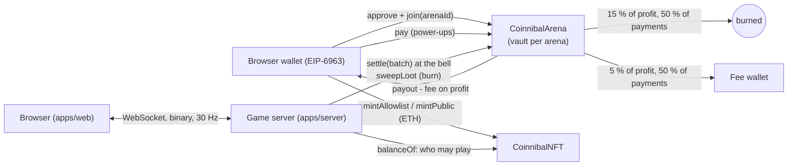

# Coinnibal

**You are small change with a big appetite.** Coinnibal is a cute coin-eats-coin arena game on
Robinhood Chain (an Arbitrum Orbit L2, gas token ETH). Its game token will be launched on Pons (mainnet only,
after the NFT mint; amounts are shown with `TOKEN_SYMBOL`, default "tokens"). Eat or be eaten.
You are a coin: eat food and smaller coins, run from bigger ones, and when the five-minute bell rings
whatever you swallowed is paid out on chain.

Coinnibal was formerly Elymum (docs/OPERATIONS.md, "The name: Coinnibal (formerly Elymum)", lists the few names the
live server keeps). The domain and the X handle are configuration.

The product flow is WL → Mint → Play: people apply for the whitelist, get a Coinnibal NFT, and the game opens for
holders. No visitor copy names a mint price (the mint page, once open, reads the contract's live price); the public
mint is planned on OpenSea (the link @coinnibalfun posts), and the contract's own allowlist and public phases and
`/mint` are the owner's tools until the owner decides how they fit. The money rules live in two Solidity contracts;
the game itself runs on an authoritative server; the owner deploys and runs everything from their own wallet in
`/admin`.

Status: the contracts and the mint system are ready and run from `/admin`; the public site is information-only
(game, mint, WL and collab closed) until the owner opens them in `/admin` → Settings. Coinnibal runs on Robinhood Chain only: Robinhood Chain Testnet (chain id
46630) now, Robinhood Chain (4663) later, switched with `CHAIN_ID`. The contracts have not been audited, and a game
played with a token of real value may need a licence where you operate.

The system is described in [`docs/ARCHITECTURE.md`](docs/ARCHITECTURE.md), the economy in
[`docs/ECONOMY.md`](docs/ECONOMY.md) and the chain facts in [`docs/RESEARCH.md`](docs/RESEARCH.md) (the specs under
`docs/specs/` are historical: they describe the earlier Elysium build). The visual reference is [`docs/design/storybook-reference.html`](docs/design/storybook-reference.html) (the "Ring
Storybook" language).

## Screenshots

The old screenshots were removed with the redesign. The screenshot tours in `apps/web/scripts`
(`lobby.mjs`, `docs.mjs`, `gameview.mjs`, `shot.mjs`) regenerate them against `pnpm demo`; they will be
added back under `docs/images/` once the Ring Storybook UI has landed. Until then,
[`docs/design/storybook-reference.png`](docs/design/storybook-reference.png) shows the look.

## Key features

- Real-time arena game: a 30 Hz authoritative server (physics, rounds) and a canvas client with
  split, eject, viruses, power-ups and floor loot.
- Rounds, not cash-outs: paid arenas play 5-minute wall-clock rounds (the full 5:00 of play, then a 30 s break after
  each bell; joins closed in the final minute). Join late or buy back in; everyone alive at the bell is paid their value. No fee
  is taken from the ticket; the arena contract takes 20 % of a ticket's **profit** only (15 % burned, 5 % to the fee
  wallet, the team wallet; NFT holders 10 %: 8 % + 2 %); a loss pays nothing.
- Four rooms, tickets priced in US dollars and paid in the game token: the $1 Room, the $3 Room, the $5 Room and the
  $10 Room (NFT holders only). Only people play the official arenas: no
  house bots (on the testnet each arena also has a labelled TEST room with practice bots that carry no value).
- On-chain money in one contract: `CoinnibalArena` holds the ticket money (the contract's `entryFee`) in per-arena vaults; a payout
  can never exceed the vault, a settlement cannot replay, players refund unsettled tickets themselves
  after 24 h, floor loot is only ever burned. Power-ups (packs priced in US dollars, several in one cart, one
  payment) are paid to the same contract (`pay`: half burned, half to the fee wallet).
- Coinnibal NFT: an ERC-721 with an allowlist (Merkle root) and a public phase, priced in ETH at the owner's USD
  target `MINT_USD_CENTS` (synced from `/admin` or kept there by the server's price keeper within the owner's bounds;
  no visitor copy names a price or shows the target; the mint page, once open, shows the contract's live price in
  ETH).
- Sign-In with Ethereum (EIP-4361) for every wallet that speaks EIP-6963 (MetaMask, Rabby, Coinbase
  Wallet, OKX and the rest), smart wallets included (ERC-1271 / 6492).
- Owner-run admin panel: deploy both contracts from your wallet, register them, set the token,
  create arenas, publish the allowlist, open the mint, review the WL and collabs, integrity flags,
  bans and held payouts. Every transaction is previewed before the wallet prompt.
- Practice: two leagues of free practice rooms; nothing touches the chain.
- Custom rooms: your own rules for a small fee in the game token, half burned and half to the team wallet (NFT
  holders: one free room a day); free rooms may add fair
  practice bots (count and difficulty, tagged BOT, no value, they see only what a player sees).
- Share on X and Link X: result and kill cards drawn by the server, opened in X's composer; a player can tie an X
  account to the coin by posting a code (no X API), so the `@handle` shows on the coin and eaters can tag it.

## How it works



1. A player signs in with SIWE (free, no transaction), approves the game token and calls `join` on the
   arena: the whole ticket price moves into that arena's vault and a session opens with the fee rates fixed.
2. The server seats the ticket. Value moves between players off chain as they eat each other; a
   crash-safe journal keeps the books (live values + floor loot + pending payouts = tickets paid in − payouts).
3. At the bell the server settles every live ticket of the arena in one `settle` batch: each is paid its value
   less the fee on its profit (ticket 1,000, payout 2,000: 150 burned, 50 to the fee wallet, 1,800 to the player;
   at most 25 % together); floor loot is burned with `sweepLoot`. A ticket that was never played is cancelled with its full ticket price back (`cancel`).
4. If the server never settles a ticket, the player calls `refund` after 24 h. If a payout transfer
   fails, the session is finalized with what is `owed` and the player collects it with `refund`.

Details: [docs/ARCHITECTURE.md](docs/ARCHITECTURE.md).

## Tech stack

| Layer | Stack |
|---|---|
| Contracts | Solidity 0.8.28 (Shanghai), OpenZeppelin 5.6.1, Hardhat 3, forge-std tests (unit + fuzz) |
| Client SDK / admin CLI | TypeScript, viem |
| Game server | Node 22, `ws`, viem, a binary protocol, a crash-safe JSON journal |
| Web | Vite + React, canvas renderer, motion, synthesized WebAudio; Fraunces, DM Sans, Geist Mono |
| Tooling | pnpm workspaces, Vitest, Playwright, Docker, GitHub Actions |

## Project structure

| Path | What it is |
|---|---|
| `packages/contracts` | `CoinnibalArena`, `CoinnibalNFT`, `TestToken`; the committed `src/artifacts.ts` (ABIs, bytecode, pinned runtime code hashes) |
| `packages/sdk` | viem client: reads, call builders, deploy helpers, Merkle tree, ETH/USD price, the admin CLI (`pnpm admin`) |
| `packages/shared` | Game rules, protocol, chains table, arenas, SIWE message, palette |
| `packages/art` | Coin drawing shared by the web renderer and the films |
| `apps/server` | The game server (rooms, rounds, ledger, journal, chain gateway, site and admin API, integrity, practice bots for free custom rooms and the testnet's test arenas, the shop, Share on X and Link X) |
| `apps/web` | The client: landing, `/wl`, `/collab`, `/mint`, `/faucet`, `/play`, `/docs`, `/admin` |
| `scripts/` | `demo.mjs`, `localnet.mjs`, `localnet-fund.mjs`, `dev-browser.mjs`, `record-walkthrough.mjs` and the Dev Wallet |
| `brand/` | The brand kit generator (PNGs into `brand/out/`, gitignored: X avatar and banner, OG card, favicons, posts, stickers, arena posters) |
| `media/` | Film pipelines (promo, gameplay, how-to-play, mint film, roadmap chomp) |
| `docs/` | [PROJECT](docs/PROJECT.md), [ARCHITECTURE](docs/ARCHITECTURE.md), [ECONOMY](docs/ECONOMY.md), [NFT-DESIGN](docs/NFT-DESIGN.md), [RESEARCH](docs/RESEARCH.md), [DEPLOY](docs/DEPLOY.md), [OPERATIONS](docs/OPERATIONS.md), the historical specs and the design reference |

## Getting started

Requirements: Node 22+, pnpm 10 (`corepack enable`).

```bash
pnpm install
pnpm demo                       # everything on a fake chain: lobby, sign-in, tickets, rounds, bell
DEV_FAKE_TOKEN=0 pnpm demo      # the same with the game token unset ("Opening soon" until POST /api/dev/token)
ROUND_SECONDS=90 pnpm demo      # shorter rounds, to see the bell sooner
pnpm demo --browser             # also open a Chromium with the Dev Wallet (needs a display)
```

`pnpm demo` starts the server with `NODE_ENV=development DEV_FAKE_CHAIN=1 DEV_FAKE_TOKEN=1` and the web
dev server on http://localhost:5173. Any EVM wallet signs in (no funds needed).

### A real local chain

```bash
pnpm demo:localnet              # hardhat node + contracts deployed with the SDK + the production server
pnpm demo:localnet --browser    # ... and the Dev Wallet as the contract owner (Hardhat account #0)
node scripts/localnet-fund.mjs 0xYourAddress     # 10 ETH + 100,000 test tokens
```

`demo:localnet` starts `hardhat node` (chain id 31337), deploys `TestToken`, `CoinnibalArena` and
`CoinnibalNFT` from Hardhat account #0 (the owner and admin), sets the token, creates the four arenas,
opens the mint and runs the built server with `EVM_RPC_URL`, `SERVER_PRIVATE_KEY` (Hardhat account #1),
`ARENA_ADDRESS`, `NFT_ADDRESS` and `ADMIN_WALLETS`. To run the chain alone: `pnpm localnet`
(`--no-token` stops before `setToken`, like a fresh deploy); the server env is written to
`.localnet/server.env`.

### Tests

```bash
pnpm typecheck && pnpm test     # every package
pnpm contracts:build            # compile + export packages/contracts/src/artifacts.ts (commit it)
pnpm contracts:test             # forge-std unit and fuzz tests
pnpm -F @coinnibal/server e2e      # a real hardhat node + the real server: deploy, register, setToken, play, settle
```

`pnpm check` runs everything CI runs, one suite at a time (`pnpm check:fast` skips the contracts and the web
build). CI (`.github/workflows/ci.yml`) runs an English-only guard, a dead-export check, builds the contracts and fails when the
exported artifacts are out of date, runs every package's typecheck and tests, builds the server and
the web, and builds the Docker image.

### Deploying

Deploy the server (Docker on a VPS: deploy/vps/README.md), then deploy the contracts from your own wallet in
`/admin`: Deploy Arena → Deploy NFT → register both → pin them in the site build → publish the allowlist → open the
mint → set the token (when it exists) and pin it → create the arenas → open the game. The pins are the one step in
the VPS shell: the site trusts only the contracts it was built with, so `/admin` → Setup → Site pins shows the
`COINNIBAL_PIN_*` lines for `/opt/elymum/.env`, then `coinnibal-compose up -d --build app` rebuilds it. Moving to the
mainnet is a server setting plus that rebuild with the mainnet pins. Step by step: [docs/DEPLOY.md](docs/DEPLOY.md).
Day-to-day running (gas for the server key, the allowlist, the mint price, pausing, ownership):
[docs/OPERATIONS.md](docs/OPERATIONS.md).

## Security and trust model

- Players buy tickets, collect what they are owed and refund unsettled tickets after 24 h. They
  cannot settle tickets or undo a result.
- The server key settles tickets (any payout up to the arena's vault) and burns floor loot. It cannot
  move tokens to a wallet of its choice, change the config or touch the fee wallet. Because the owner can
  replace it, trusting the server means trusting the owner. Protect it; it only needs a little ETH.
- The owner (Ownable2Step) sets the token once, the fee pair on profit (at most 25 %), the burn mode, the fee wallet, the server
  authority, arenas and pause; on the NFT, the phase, the allowlist root, the price, the price keeper and its
  bounds (only the keeper is held to them), limits, metadata and withdrawals. The owner cannot change an open
  ticket's rates or the token once set.
- The game outcome is trusted: who ate whom is decided by the server. Integrity detectors flag
  collusion and bot-like play for review; an optional auto-hold keeps high-risk payouts for a decision.

More: [docs/ARCHITECTURE.md#trust-model](docs/ARCHITECTURE.md#trust-model).

## Documentation

[Project overview](docs/PROJECT.md) · [Architecture](docs/ARCHITECTURE.md) · [Deploy](docs/DEPLOY.md) ·
[Operations](docs/OPERATIONS.md) · [Economy](docs/ECONOMY.md) · [Research: Robinhood Chain and Pons](docs/RESEARCH.md) ·
[Brand kit](brand/README.md) · [Films](media/README.md)

## License

MIT, see [LICENSE](LICENSE).
