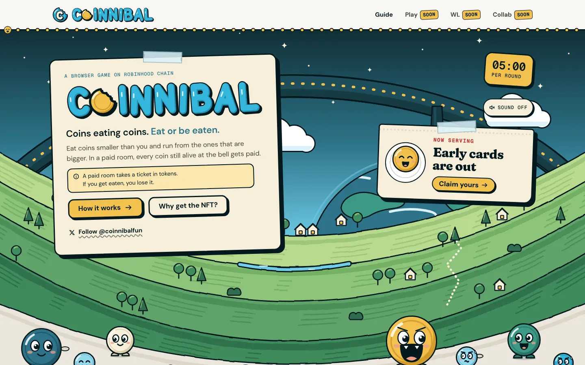
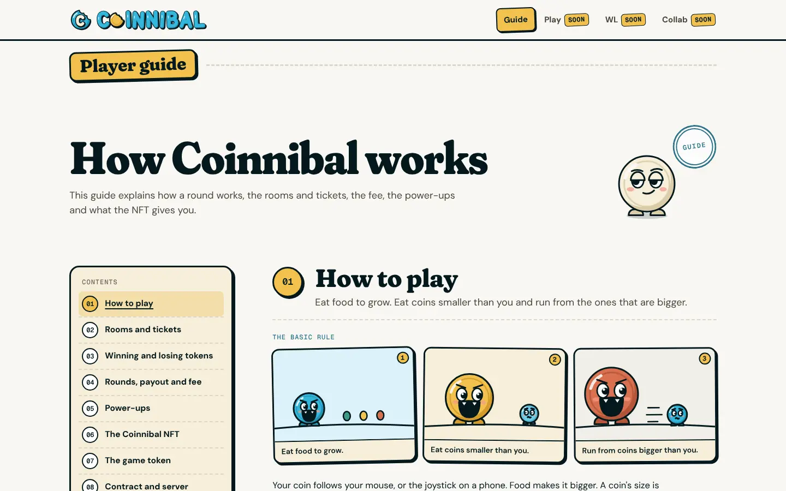
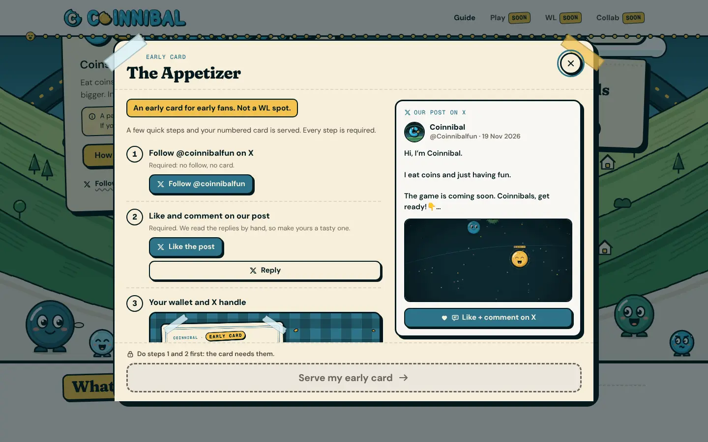
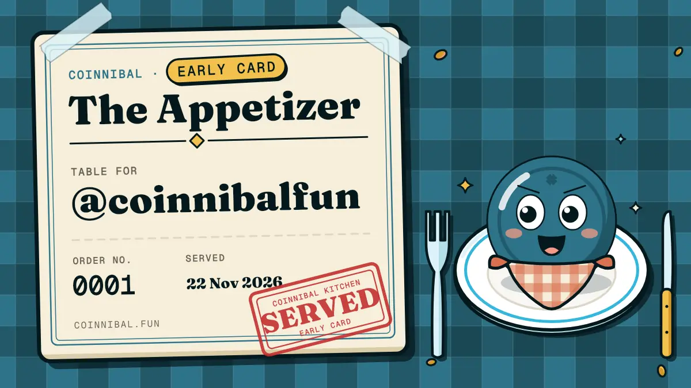
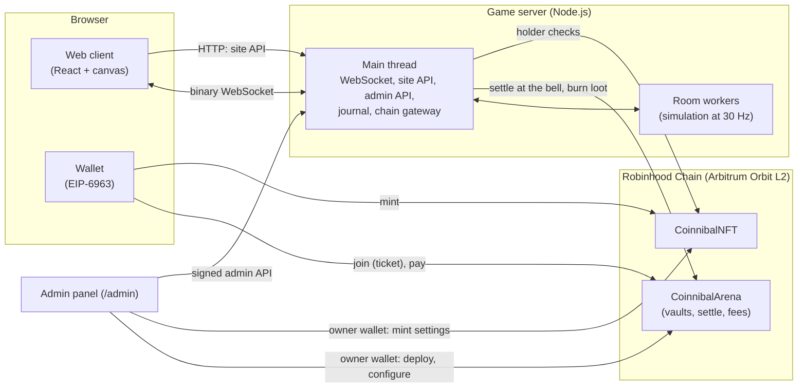

<div align="center">

# Coinnibal

**Coins eating coins. Eat or be eaten.**
A real-time coin-eats-coin browser arena game with on-chain settlement on Robinhood Chain.

[](https://github.com/CoinnibalFun/Coinnibal/actions/workflows/ci.yml)
[](LICENSE)
[](https://docs.robinhood.com/chain/)
[](https://arbitrum.io/orbit)
[](https://www.typescriptlang.org/)
[](packages/contracts)

[Website](https://coinnibal.fun) · [Player guide](https://coinnibal.fun/docs) · [X / Twitter](https://x.com/coinnibalfun) · [Documentation](#documentation)



</div>

## What is Coinnibal?

Coinnibal is a browser `.io`-style arena game in which **you are a coin**. Eat food and smaller coins to grow, run
from bigger ones, split to strike, and survive.

- **Paid rooms.** A ticket is paid in the game token. The tokens you pay become your coin's value; when you eat
  someone, their value becomes yours.
- **The five-minute bell.** Paid rooms play 5-minute rounds. Every coin still alive at the bell is **paid out on
  chain** at its current value. There is no cash-out button and no house: value only moves between players.
- **Fee only on profit.** The ticket itself is never charged. At the bell the arena contract takes a share of a
  ticket's *profit* only (part burned, part to the fee wallet); a loss pays no fee.
- **NFT perks.** Holders of the Coinnibal NFT get a lower fee on profit, access to a holders-only room and other
  in-game perks.
- **Free practice.** Practice rooms and custom rooms with fair practice bots let anyone play without touching the
  chain.

The live site is **[coinnibal.fun](https://coinnibal.fun)**; news and announcements are on
**[@coinnibalfun](https://x.com/coinnibalfun)**.

## Why Robinhood Chain (Arbitrum Orbit)

Coinnibal needs cheap, fast, final settlement for many small payouts every five minutes. Robinhood Chain is an
**Arbitrum Orbit L2** with **ETH as gas**, full EVM equivalence and low fees, which makes it a good fit:

- **On-chain settlement.** Tickets are held in per-arena vaults in the `CoinnibalArena` contract. At the bell the
  server settles a whole arena in one `settle` batch; a payout can never exceed the vault, a settlement cannot be
  replayed, and players can refund an unsettled ticket themselves after 24 hours.
- **Standard tooling.** Solidity, OpenZeppelin, viem, EIP-6963 wallets and Sign-In with Ethereum work unchanged.
- **One chain, two networks.** The game runs on Robinhood Chain Testnet today and moves to Robinhood Chain mainnet
  with a server setting and the same deploy flow ([docs/RESEARCH.md](docs/RESEARCH.md)).

### Deployed contracts (Robinhood Chain Testnet, chain id 46630)

| Contract | Address |
|---|---|
| `CoinnibalArena` (ticket vaults, settlement, fees) | [`0xCeE7F0A67AFc63D44a3314f8F2890A44399BeD0c`](https://explorer.testnet.chain.robinhood.com/address/0xCeE7F0A67AFc63D44a3314f8F2890A44399BeD0c) |
| `CoinnibalNFT` (ERC-721, allowlist and public phases) | [`0xE8d601B7D415f1f23647115Ae1E38360BC1414Ff`](https://explorer.testnet.chain.robinhood.com/address/0xE8d601B7D415f1f23647115Ae1E38360BC1414Ff) |
| `TestToken` (testnet game token, faucet) | [`0xfD31b13e6684465a3B3161375E7F82F6A3DeEa11`](https://explorer.testnet.chain.robinhood.com/address/0xfD31b13e6684465a3B3161375E7F82F6A3DeEa11) |

The live values are always served by the site at [`/api/config`](https://coinnibal.fun/api/config). RPC:
`https://rpc.testnet.chain.robinhood.com`, explorer: [explorer.testnet.chain.robinhood.com](https://explorer.testnet.chain.robinhood.com).

## Screenshots

| Landing | Player guide |
|---|---|
|  |  |
| **The Appetizer sheet** | **An Appetizer early card** |
|  |  |

## Key features

- **Real-time arena game.** A 30 Hz authoritative server (physics, rounds, ledger) and a canvas client with split,
  eject, viruses, power-ups and floor loot. Desktop and mobile controls.
- **Token economy.** Four rooms with tickets priced in US dollars and paid in the game token; a fee on profit only;
  power-ups and custom rooms paid on chain (half burned). Nothing in Coinnibal mints the game token
  ([docs/ECONOMY.md](docs/ECONOMY.md)).
- **Integrity and anti-cheat.** The server is authoritative (clients send only inputs). Detectors flag collusion,
  feeding and bot-like play for review; an optional auto-hold keeps high-risk payouts until the owner decides.
  A crash-safe journal keeps the books balanced at all times.
- **Auto-scaling rooms.** Each arena runs as many instances of 50 seats as demand needs, opened ahead of demand and
  drained when quiet, all on the same on-chain vault. Rooms run in worker threads across the available cores.
- **Wallets and sign-in.** Any EIP-6963 wallet (MetaMask, Rabby, Coinbase Wallet, OKX and others), smart wallets
  included (ERC-1271 / ERC-6492), with Sign-In with Ethereum (EIP-4361).
- **Owner admin panel.** Deploy the contracts from the owner's wallet, register them, create and price arenas,
  manage the allowlist and the mint, review integrity flags and held payouts. Every transaction is previewed
  before the wallet prompt.
- **Share cards.** Result and kill cards drawn by the server and opened in X's composer; players can link their X
  account to their coin.
- **The Appetizer.** A numbered early card for early fans, served on the site and shared on X.

## Architecture



1. A player signs in with SIWE (free), receives a single-use join permit from the server and calls `join` on the
   arena: the ticket moves into that arena's vault.
2. The server seats the player. Value moves between players off chain as they eat each other; a crash-safe journal
   keeps `live values + floor loot + pending payouts = tickets paid in - payouts` at all times.
3. At the bell the server settles every live ticket of the arena in one batch: each is paid its value less the fee
   on its profit; floor loot is burned.
4. If the server never settles a ticket, its owner calls `refund` after 24 hours.

The full design, including the trust model and the invariants, is in [docs/ARCHITECTURE.md](docs/ARCHITECTURE.md).

## Tech stack

| Layer | Stack |
|---|---|
| Contracts | Solidity 0.8.28, OpenZeppelin 5, Hardhat 3, forge-std unit, fuzz and invariant tests |
| SDK / admin CLI | TypeScript, viem |
| Game server | Node.js 22, `ws`, worker threads, a binary protocol, a crash-safe journal, viem |
| Web client | Vite, React, canvas renderer, WebAudio |
| Tooling | pnpm workspaces, Vitest, Playwright, Docker, GitHub Actions |

## Repository layout

| Path | Contents |
|---|---|
| [`apps/server`](apps/server) | The authoritative game server: rooms and rounds, ledger and journal, chain gateway, site and admin API, integrity, shop, share cards, load and stress harnesses |
| [`apps/web`](apps/web) | The web client: landing, guide (`/docs`), mint, play, admin panel |
| [`packages/shared`](packages/shared) | Game rules, protocol, chains table, arenas, fees, SIWE message |
| [`packages/sdk`](packages/sdk) | viem client: reads, call builders, deploy helpers, Merkle tree, the admin CLI |
| [`packages/art`](packages/art) | Coin character drawing shared by the client, the server's cards and the films |
| [`packages/contracts`](packages/contracts) | `CoinnibalArena`, `CoinnibalNFT`, `TestToken` and their tests |
| [`deploy`](deploy) | Docker and VPS deployment (Caddy, systemd timers, backups, alerts) |
| [`docs`](docs) | Project documentation (see [Documentation](#documentation)) |
| [`media`](media) | Film pipelines (promo, gameplay, how-to-play, launch films) |
| [`brand`](brand) | Brand kit generator (social art, favicons, stickers) |
| [`scripts`](scripts) | Local demo, local chain, checks |

## Getting started

**Prerequisites:** Node.js 22+ and pnpm 10 (`corepack enable`).

```bash
pnpm install
pnpm demo                 # server + web client on a fake chain: sign in, buy tickets, play rounds
ROUND_SECONDS=90 pnpm demo   # shorter rounds, to reach the bell sooner
```

`pnpm demo` starts the game server with a simulated chain and the web dev server on <http://localhost:5173>. Any
EVM wallet can sign in; no funds are needed.

To run against a real local chain (a Hardhat node with the contracts deployed through the SDK):

```bash
pnpm demo:localnet
node scripts/localnet-fund.mjs 0xYourAddress   # 10 ETH + test tokens
```

Other useful commands:

| Command | What it does |
|---|---|
| `pnpm dev` | Server and web client in watch mode |
| `pnpm check:fast` | The CI checks without the contracts build and the web build |
| `pnpm check` | Everything CI runs, one suite at a time |
| `pnpm contracts:build` / `pnpm contracts:test` | Compile the contracts and export the artifacts / run the Solidity tests |
| `pnpm -F @coinnibal/server e2e` | End to end on a Hardhat node: deploy, register, play, settle |
| `pnpm -F @coinnibal/server stress` | Load and stress harness against the real server |

## Deployment

The game server and the website ship as one Docker image behind Caddy on a VPS. The owner then deploys the
contracts from their own wallet in `/admin`, in one flow that registers them with the server and pins them with a
signed message. Step by step: [docs/DEPLOY.md](docs/DEPLOY.md) and [deploy/vps/README.md](deploy/vps/README.md);
day-to-day running: [docs/OPERATIONS.md](docs/OPERATIONS.md).

## Testing and quality

`pnpm check:fast` (and the full `pnpm check`, which CI runs on every push) covers:

- an **English-only guard** and a **dead-export check** across the repository;
- **type checking** of every package (strict TypeScript);
- **unit and integration tests** for the shared rules, the SDK, the art, the web client and the server, including
  the server run with room worker threads;
- a **money simulation**: token conservation under injected faults, on a model of the contract and on a Hardhat
  node;
- an **economy simulation** of fees, burns and payouts;
- in the full run, the **contracts build** (artifacts must be committed and in sync) and the **Solidity unit, fuzz
  and invariant tests**, plus the web build and the Docker image in CI.

Load and stress testing: `pnpm -F @coinnibal/server stress` and `pnpm -F @coinnibal/server load` drive the real
server with many WebSocket clients; measured capacity is in [docs/ARCHITECTURE.md](docs/ARCHITECTURE.md#capacity-measured).

## Security

- The contracts **have not been audited**. Use them at your own risk.
- The game outcome is decided by the authoritative server; the contracts bound what the server key can do (it can
  only pay out up to an arena's vault and burn floor loot). The trust model is in
  [docs/ARCHITECTURE.md](docs/ARCHITECTURE.md#trust-model).
- Please report vulnerabilities privately; see [SECURITY.md](SECURITY.md).

## Documentation

| Document | What it covers |
|---|---|
| [docs/PROJECT.md](docs/PROJECT.md) | Project overview: the game, money, architecture and operations on one page |
| [docs/ARCHITECTURE.md](docs/ARCHITECTURE.md) | System design: money flow, invariants, trust model, server and web internals, threads, capacity |
| [docs/ECONOMY.md](docs/ECONOMY.md) | The economy: tickets, the fee on profit, power-ups, burns, custom rooms, the NFT |
| [docs/NFT-DESIGN.md](docs/NFT-DESIGN.md) | The Coinnibal NFT collection: art, rarity and fair reveal |
| [docs/RESEARCH.md](docs/RESEARCH.md) | Robinhood Chain and Pons research: chain facts and sources |
| [docs/DEPLOY.md](docs/DEPLOY.md) | Setup and deployment, testnet to mainnet |
| [docs/OPERATIONS.md](docs/OPERATIONS.md) | Operations guide: admin panel, server key, integrity, monitoring, scaling, emergencies |
| [docs/design/storybook-reference.html](docs/design/storybook-reference.html) | The visual design reference ("Ring Storybook") |
| [deploy/vps/README.md](deploy/vps/README.md) | Running the game server on a VPS |
| [brand/README.md](brand/README.md) | Brand kit generator |
| [media/README.md](media/README.md) | Film pipelines |

## Roadmap

1. **Whitelist** - allowlist applications on the site.
2. **NFT mint** - the Coinnibal NFT, allowlist first, then public.
3. **Game** - paid arenas open on Robinhood Chain Testnet, then on mainnet.
4. **Token** - the game token launches on Robinhood Chain mainnet and is set on the arena.
5. **Mainnet** - the full game on Robinhood Chain mainnet, after a security review.

## Contributing

Contributions are welcome. Please read [CONTRIBUTING.md](CONTRIBUTING.md) and the
[Code of Conduct](CODE_OF_CONDUCT.md) first.

## License

[MIT](LICENSE).

**Disclaimer:** Coinnibal is experimental software. Playing with a token of real value may be regulated where you
live; check your local rules.
