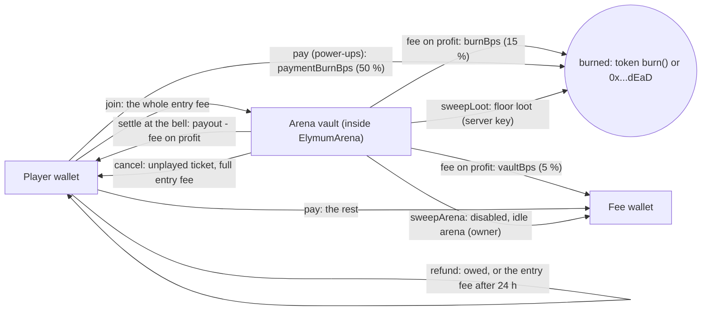

# Coinnibal architecture

Coinnibal is a hybrid: an authoritative game server runs the real-time world, and Solidity contracts on
**Robinhood Chain** (an Arbitrum Orbit L2, gas in ETH) hold the money rules. The browser signs its own
transactions (ticket, refund, power-up payment, mint); the server key signs only settlements, cancels and loot
burns. Robinhood Chain is the only chain: the testnet now, the mainnet later, chosen with `CHAIN_ID`
(docs/RESEARCH.md). The economy is in [ECONOMY.md](ECONOMY.md), operations in [OPERATIONS.md](OPERATIONS.md).

```
Browser (apps/web) --WebSocket, binary, 30 Hz--> Game server (apps/server) --settle / cancel / sweepLoot--> ElymumArena
     |  \__ approve + join / refund / pay (player wallet) _______________________________________________/
     \_____ mintAllowlist / mintPublic (ETH) ---------------------------------------------------------> ElymumNFT
                                     Game server --balanceOf (who may play), setPrice (keeper)--> ElymumNFT
```

## Repository

| Package | Role |
|---|---|
| `packages/contracts` | `ElymumArena` (v3), `ElymumNFT`, `TestToken` (testnet / local), `HolderCheck`; Hardhat 3 with forge-std unit, fuzz and invariant tests; `src/artifacts.ts` (ABIs, bytecode, pinned `runtimeCodeHash`) is generated by `scripts/export-artifacts.mjs`, committed and checked in CI |
| `packages/shared` | Everything both sides agree on: rules (`constants.ts`), the wire protocol (`protocol.ts`, `PROTOCOL_VERSION`), **the fee module (`fees.ts`)**, the Robinhood Chain networks (`chains.ts`), arenas and their USD pricing (`arena-pricing.ts`), boosts and shop defaults, custom rooms, the SIWE message, the palette |
| `packages/sdk` | viem reads and call builders for the contracts (`arena.ts`, `nft.ts`), operations helpers and refusals (`ops.ts`), deploy, errors, ETH/USD price, the Merkle allowlist, the admin CLI (`pnpm admin`) |
| `packages/art` | The Storybook coin and symbol drawings shared by the web and the server's emblem SVG |
| `apps/server` | Rooms and rounds, the off-chain ledger and journal, the chain gateway, the price keeper, the site / admin API, integrity, the shop, custom rooms, practice bots |
| `apps/web` | The site, the game client, the mint, the faucet page and `/admin`; wallets through EIP-6963 and viem |

**One fee module.** `packages/shared/src/fees.ts` mirrors `ElymumArena.computeFees` exactly (bigint, each share
rounded down). The server (death and round stats, conservation), the web (ticket sheet, round receipt, guide, admin
examples) and the tests use it; the contract is the authority and the server reads the live rates from `config()`.

## Robinhood Chain

`packages/shared/src/chains.ts` holds the two networks and the local node; there is no registry of other chains.

| Key | Chain id | Public RPC | Explorer |
|---|---|---|---|
| `testnet` (default) | 46630 | `https://rpc.testnet.chain.robinhood.com` | `https://explorer.testnet.chain.robinhood.com` |
| `mainnet` | 4663 | `https://rpc.mainnet.chain.robinhood.com` | `https://robinhoodchain.blockscout.com` |
| `localnet` (development and tests only) | 31337 | `http://127.0.0.1:8545` (`hardhat node`) | none |

- **Server:** `CHAIN_ID` (46630 by default; anything else refuses to start) and `EVM_RPC_URLS` (a comma list in
  order: a provider, then the public RPC; `EVM_RPC_URL` alone still works). The RPC's `eth_chainId` is checked: an
  RPC of another chain keeps the arenas off (`!!! chain: EVM_RPC_URL serves chain …`), a fallback of another chain is
  left out.
  `/api/config` publishes `{ chainId, chainName, testnet, faucetUrl, rpcUrl, explorerUrl, fees, … }`.
- **Web:** `VITE_CHAIN_ID` names the network before the server answers; the server's network wins. Wallets are
  asked to switch to (or add) exactly the server's chain. Copy says "ETH" and uses `{chain}` for the network's name,
  filled in by `translate()` from the active network.
- **State** is keyed by chain id (`DATA_DIR/chains/<id>/`): the testnet's records stay on file when `CHAIN_ID` moves
  to mainnet.

## Money flow (ElymumArena v3)



### Ticket lifecycle

1. **Join.** The web checks the allowance and sends `approve` when it is short (the entry fee of 1, 5, 10 or 20
   tickets of that room, the player's choice with 5 preselected; capped at 20 entry fees, never unlimited; the wallet
   sheet shows what is left in tickets and revokes it), then `join(arenaId)`. Before
   either, the arena must be the one the web build pins, with the compiled runtime code (see Web internals). The contract pulls the entry
   fee with a balance-delta check (fee-on-transfer tokens are refused), opens a session with a global id and fixes
   the ticket's fee rates (`burnBps`, `vaultBps`; the holder pair for an emblem holder when it is lower). One open
   session per player per arena. The whole entry fee is the coin's starting value.
2. **Play.** The server seats the ticket. Value moves between players off chain (`stake/ledger.ts`).
3. **Settle.** At the bell, or when a player is eaten or leaves by an operator exit, the server queues a settlement
   in the journal. Due items of an arena go out as **one `settle(Settlement[])` batch** (chunked at 40). Each item
   is applied or **skipped with an event** (`SettleSkipped`: unknown arena, session mismatch, already finalized,
   vault too small) instead of reverting the batch. The contract computes the fee on profit per item, burns the
   batch's burn shares in one go (`FeeBurned`) and sends the fee wallet's shares in one transfer (`FeeToVault`).
4. **Two-phase payout.** The player transfer uses `trySafeTransfer`; if it fails the session is **finalized** with
   `owed`, and the player collects it with `refund`.
5. **Cancel.** A ticket that was never seated (stale after 15 minutes) is cancelled by the server: the full entry
   fee goes back, no fee.
6. **Refund.** A finalized session: `refund` pays `owed`. An unsettled session older than 24 h: `refund` pays
   `min(entryFee, vault)`.

### Fees

```
profit = max(0, payout - entryFee)
burned = floor(profit * burnBps  / 10 000)    15 % by default
toVault = floor(profit * vaultBps / 10 000)   5 % by default; burnBps + vaultBps <= 2 500 (25 %)
player = payout - burned - toVault            a loss or break-even pays nothing
```

Example: entry 1,000, payout 2,000 → 150 burned, 50 to the fee wallet, 1,800 to the player. Power-up payments
(`pay(amount, ref)`): `paymentBurnBps` (50 %) burned, the rest to the fee wallet, a `Paid(payer, ref, amount, …)`
event the server checks before crediting the pack. `pay` works while the arena is paused.

**Burn mode.** `0` (default): burned tokens go to `0x…dEaD`. `1`: the token's own `burn(uint256)`, accepted only
when the arena's balance fell by exactly the amount; an unchanged balance falls back to `0x…dEaD`, anything else
reverts (`BurnMismatch`). `/admin` and `pnpm admin status` probe whether the token's `burn()` works.

## Invariants

On chain (`ElymumArena`, custom errors; forge-std unit, fuzz and invariant tests in
`packages/contracts/test`):

1. **Solvency:** token balance = Σ vaults + Σ owed (plus tokens sent directly, which stay locked). A payout never
   exceeds its arena's vault (`InsufficientVault`, or `SettleSkipped` reason 4 inside a batch).
2. **Per-arena books:** deposited = vault + paid out + burned + fees to the fee wallet.
3. **Fees** are taken from profit only, at the ticket's rates fixed at join, at most 25 % together
   (`InvalidFee`); `cancel` and the 24 h refund take none.
4. **Burns lower supply** in mode 1 by exactly the burned amount (invariant test with a burnable token).
5. One open session per player per arena (`SessionExists`); no replayed settlement (the `sessionId` must match,
   reason 2).
6. Floor loot is only burned: `sweepLoot(arenaId, sweepId, amount)` needs a strictly increasing `sweepId`
   (`SweepIdNotIncreasing`) and is capped by the vault.
7. The token is set once (`TokenAlreadySet`); `rescue` never moves the game token (`CannotRescueGameToken`).
8. Pause blocks joins only; settlements, cancels, refunds, collects and `pay` keep working.
9. `sweepArena` only for a disabled arena with no open sessions; the vault goes to the fee wallet.
10. Checks-effects-interactions everywhere, `nonReentrant` on every external entry point, Ownable2Step,
    `renounceOwnership` disabled.

`ElymumNFT`: Merkle allowlist (OpenZeppelin `MerkleProof`, double-hashed leaves), per-wallet limits per phase,
`maxSupply` only down, excess payment refunded, `withdraw` to the treasury, `freezeMetadata` forever, royalties at
most 10 %; the price keeper may call `setPrice` only inside the owner's `[minPrice, maxPrice]`.

Off chain (the server; tests in `apps/server/test`):

11. **Value conservation per arena:** Σ live values + Σ floor loot + Σ pending payouts and sweeps + Σ forfeited =
    Σ entry fees − Σ paid. Only people hold value in an arena (there are no house bots). The practice bots of the
    testnet's test arenas hold none either: they are never in the arena ledger, eating one moves no value, one
    that eats a staker makes the eaten share spill as floor loot (burned at the bell unless a player takes it), and
    bots pick up no loot. The journal
    (`DATA_DIR/chains/<id>/journal.json`) is written with write-to-temp + rename.
12. **Crash recovery:** live tickets found in the journal at start are settled at their last journaled value; loot
    is restored. An arena whose vault does not cover what the journal owes it stays disabled (`!!! arena #N KEPT
    DISABLED`).
13. **One arena contract per journal:** while the journal owes money on an arena contract the server refuses to
    switch to another one (`POST /api/admin/contracts` answers 409 `wrong_state`).
14. **Stale tickets:** a ticket nobody played for `STALE_SESSION_AFTER_S` (15 min, on the chain's clock: the latest
    block's timestamp) is cancelled (full entry fee back); in an arena that is disabled, paused or closing for a
    re-price, at once. While a quarantined journal (`journal.json.corrupt-*`) exists the stale sweeper stays off.
15. **Guards before money leaves:** nothing is sent while the journal cannot be written (a settlement sent from
    memory alone would not survive a crash together with the change that matched it); a payout above its round's pool
    (`roundPool`: the entry fees seated in its instance that round) is held (without a pool: above
    `PAYOUT_GUARD_MULTIPLE` entry fees); an arena whose vault does not cover its journal pays nothing (the books
    guard); a ticket the server settled that is open again (a reorg) is re-sent with the same payout
    (`settled.jsonl`), never refunded at the entry fee.
16. **Refunds the server did not send:** a held (or never-sent) settlement whose ticket the player refunded after
    24 h is dropped and the difference (payout − entry fee) journaled as a forfeit, so (11) keeps holding.

The money simulation (`test/money-sim.ts`, `pnpm -F @elymum/server money-sim`) checks 11 to 16 together: the real
rooms, journal and settlement worker against the contract model or a hardhat node with the real contract, with
random joins, eats, disconnects, unplayed tickets, holds, failed transfers, RPC errors, ambiguous sends, lost
receipts, outages, worker crashes, restarts and days passing; after every chain pass the vault must equal the rooms +
the journal + forfeits + unseated tickets exactly, and at the end every ticket is closed exactly once. The test-arena
scenario (`testArenas`, `money-sim --test-arenas`) adds a test arena with practice bots next to every arena's
instances (players eat bots, bots eat stake cells) and must hold the same books to the unit.

## Trust model

| Actor | Can | Cannot |
|---|---|---|
| Player | buy tickets, collect `owed`, refund an unsettled ticket after 24 h, pay for power-ups, mint NFTs, edit the profile | settle a ticket, undo a result, move other players' tokens |
| Server key (`serverAuthority`, optionally the NFT `priceKeeper`) | settle any open session with any payout up to the vault (so, with a ticket bought from a wallet of its own, take an arena's open stakes less the fee on profit); cancel unplayed tickets; burn floor loot up to the vault; re-price the NFT inside the owner's bounds | touch owed payouts, the fee wallet or the config, mint any token, price the NFT outside the bounds |
| Owner (Ownable2Step) | arena: set the token once, the fee pair (≤ 25 % of profit), the holder pair and NFT (8 % + 2 % by decision), the burn mode, the payment burn share, the fee wallet, the server authority, pause, create / update / sweep arenas, rescue non-game tokens; NFT: phase, root, price, bounds, keeper, limits, supply (down only), metadata, royalty, treasury, owner mint, withdraw | change the token once set, change an open ticket's rates, take an arena vault directly |
| Fee wallet | receives the fee wallet's share of profits and payments, and a swept arena's vault | nothing else on chain |
| Server operator | rooms, round length (`ROUND_SECONDS`, `ROUND_JOIN_CLOSE_SECONDS`, `ROUND_BREAK_SECONDS`), who may play (`GAME_ACCESS`), map sizes | anything on chain except through the server key |

- **The game outcome is trusted.** A buggy or malicious server could split a vault wrongly between that arena's
  players or burn the wrong amount of it (never more than the vault). The owner can replace the server key, so
  trusting the server means trusting the owner. **Protect the server key** (OPERATIONS.md, "What the server key can
  do"). The server itself refuses to pay what its own books do not support: a payout above what every ticket of its
  round put in is held for an admin, and nothing leaves a vault that does not cover what the journal owes it (the
  books guard).
- **Fair play in arenas:** only people play in the official arenas. Practice bots exist only in free custom rooms
  and in the testnet's test arenas (both: no value), see only what a player's view shows (invisible players
  excluded) and are tagged BOT.
- Collusion, multi-accounting, sybil feeding, pacts and scripted input are detected off chain and shown to the owner
  (OPERATIONS.md, "Integrity"); the auto-hold (on by default on the mainnet) keeps a high-risk payout in the journal
  until the owner decides (or until `autoReleaseHours` pass: a false positive delays a payout, never loses it).
- **Holder perks are bound to emblem token ids** (`site/emblem-claims.ts`, `site/emblem-gate.ts`): the contract
  checks the emblem at `join` only, so the server binds each holder ticket to a token id of its wallet (from the
  NFT's `Transfer` logs) until it is settled; one token id serves one open holder ticket, one discounted power-up
  buyer and one free room a day. A ticket the emblem cannot serve is refused at the seat and cancelled in full.
- The contracts are not upgradeable and not audited.

## Server internals

- **Config** (`config.ts`; every variable in `apps/server/.env.example`): `CHAIN_ID`, `EVM_RPC_URLS` /
  `EVM_RPC_URL`, `PUBLIC_RPC_URL`, `EXPLORER_URL`, `GAS_FAUCET_URL`, `ARENA_ADDRESS`, `NFT_ADDRESS`, `TOKEN_ADDRESS`,
  `SERVER_PRIVATE_KEY` (`auto` | 0x hex | a file path), `ADMIN_WALLETS`, `AUTH_SECRET` (32+ bytes on the mainnet),
  `ADMIN_TOKEN_TTL_MIN`, `ADMIN_SECRET_EXPORT`, `GAME_ACCESS`, `MINT_USD_CENTS`, `GAS_PRICE_URL`, `TOKEN_SYMBOL`,
  `STAKE_ENABLED`, `STAKE_ARENA_IDS`, `STALE_SESSION_AFTER_S`, `DEATH_SETTLE_BATCH_S`, `PAYOUT_GUARD_MULTIPLE`,
  `GAS_FLOOR_ETH`, `GAS_RUNWAY_WARN_DAYS`, `GAS_RUNWAY_CRITICAL_DAYS`, `HEALTH_MAX_PENDING`, `HEALTH_MAX_PENDING_AGE_S`,
  `LOG_CHUNK_BLOCKS`, `RPC_MAX_RPS` (one rate or one per URL), `RPC_BURST`, `TESTNET_RPC_URL`, `GAME_WORKERS`,
  `MAX_CONNECTIONS`, `DEV_FAKE_CHAIN`, `DEV_FAKE_TOKEN`.
- **Contracts registry** (`site/contracts.ts`): `DATA_DIR/chains/<id>/contracts.json`, written by `POST
  /api/admin/contracts` after a deploy from `/admin`. The server checks the code hash (the bundled v3 build only),
  that the owner is the signed-in admin and, for the arena, that the server authority is the server key. A newly
  registered arena is picked up without a restart.
- **Chain gateway** (`chain/evm.ts`, `chain/evm-client.ts`): reads `config()` every 30 s (token, fee rates, burn
  mode, holder perks) and pushes `chain` to every client when it changes; lists arenas; runs the settlement worker
  (batches, read-back reconciliation, backoff), the loot burn with a monotonic `sweepId` kept in the journal, and
  the stale sweeper (`cancel`). Reads go through one request budget per RPC URL (`rpc-budget.ts`) and a viem fallback
  over `EVM_RPC_URLS`; concurrent `eth_call`s merge into one Multicall3 call, or a deployless multicall where the chain
  has none (probed at start). Eaten tickets (payout 0) wait `DEATH_SETTLE_BATCH_S` (6 s) to go out in one batch. The
  chain's clock (the latest block's timestamp) measures ticket ages; a server clock more than 30 s off is logged. Gas
  is ETH, paid by the server key; its runway at the last day's spend (`chain/gas-runway.ts`) is in `/admin` and
  `/api/health` (warning under 7 days, alert under 2).
- **Price keeper** (`chain/price-keeper.ts`): when the server key is the NFT's `priceKeeper` with bounds set, every
  5 minutes it reads ETH/USD (Hyperliquid's `allMids`) and re-prices to `MINT_USD_CENTS` when off by more than 2 %,
  only after two readings agree within 3 %, at most ±20 % per update, always inside the bounds.
- **Sign-in (SIWE, EIP-4361):** `/api/auth/nonce` issues the message (domain = the `PUBLIC_URL` host, the server's
  chain id); nonces are single use, 10 minutes, at most 24 unused per IP and 4 per address. ERC-1271 / 6492 smart
  wallets are verified through the RPC. Session tokens carry their issue time; an admin wallet's last
  `ADMIN_TOKEN_TTL_MIN` (2 h), are never extended, and can be revoked (`POST /api/admin/auth/revoke`). The secret
  exports (backup, migration settings) need a fresh purpose-bound signature (`site/secret-proof.ts`).
- **Who may play** (`gameAccess`: `admins` | `holders` | `public` | `maintenance`; `GAME_ACCESS` overrides):
  holders are wallets with `balanceOf > 0` on the NFT (cached 15 s, re-read uncached at every arena seat) plus the
  admins. On the testnet the default is `public`.
- **Rooms** (`rooms/manager.ts`, `rooms/room.ts`): practice ponds (Rookie and Pro leagues, 40 people), arena
  instances `arena-<id>-<n>` of `ARENA_INSTANCE_CAP` (50) people on the same vault, opened ahead of demand and
  drained when quiet by the instance scaler (`rooms/arena-scaler.ts`, OPERATIONS.md "Arena instances"; a draining
  instance takes no new seat and closes after its bell, nobody is evicted); rounds of 300 s of play plus the 30 s
  break after each bell (a 330 s cycle) aligned to Unix time, joins closed in the final 60 s and in the break
  (`ROUND_BREAK_SECONDS`, on top of the play; a join then is
  refused with `round_closed` and its `opensAt`, and the client holds the ticket until the floor opens). **No bots in practice ponds or official arenas.** Maps grow with every person and
  shrink back only when safe (base + per person, at most max; `rooms/map-settings.ts`, `DATA_DIR/site/maps.json`, `/api/admin/maps`).
- **Practice bots** (`bots/brain.ts`, `bots/practice.ts`): only in **free custom rooms**, when the creator turns them
  on (count up to 12, difficulty easy / mixed / hard), and in the testnet's **test arenas** (below). Their tuning (`BOT_TUNING`) is
  deliberately beatable: a bot re-thinks every 650 / 450 / 300 ms (easy / normal / hard) and misses a threat or a
  prey 35 / 25 / 12 % of the time. Each bot sees
  the server's view rectangle of a player of its size (no map-wide knowledge, invisible players excluded), carries
  no value, never uses power-ups and is tagged BOT. `Room` refuses bots in any other room (a room with stakes takes
  them only when it is marked `test` and its chain is a testnet).
- **Test arenas** (testnet only; `packages/shared/src/test-arenas.ts`, `rooms/test-arenas.ts`, `RoomManager`
  "Test arenas"): for every official arena one fixed extra instance `test-<arenaId>` ("Test · <arena>", instance
  number 0, `RoomInfo.test`), opened with the arena's first instance and reopened after a worker crash. It is the
  official arena path exactly: the same ElymumArena contract and vault, a normal ticket of that arena (bought with
  `join(arenaId)`, joined with `arena:<id>:test`), the same seating checks (game access, holders gate, bans, round
  windows, one session per wallet per arena across every room of the arena), rounds and bell, settlement with the
  contract's fee on profit, loot burns, the journal, crash recovery and the integrity telemetry. The one difference:
  practice bots (default 10, mixed, 3..20; the first at once, then one about every 4 s). They carry no value (see
  invariant 11). The scaler never sees them (`publicInstances` excludes them) and quick play never seats there.
  Their games count on no board: no leaderboard record, country game or "Last rounds" entry, no profile stats; their Share on X
  cards are stamped TEST and never show a payout. **Guards:** they exist only when the server's `CHAIN_ID` is a testnet (46630, or 31337 locally)
  and the RPC serves a testnet, AND the admin switch "Test arenas with bots" is on (default on on a testnet). On the
  mainnet the setting is refused (`PUT /api/admin/test-arenas` answers 409), a stored file is ignored, the room
  directory opens none and `Room` refuses to build one. Turned off, each test arena takes no new seat and closes
  once its bell settled every ticket in it (nobody is evicted).
- **Custom rooms** (`rooms/custom.ts`, `site/custom-rooms.ts`): a signed-in wallet pays a small ETH fee to the
  treasury (checked on chain by tx hash, each hash used once) and gets a room `priv-<CODE>` with its own rules
  (duration, map, traps, food, power-ups, capacity, practice bots in free rooms). A **ticket room** is an
  invite-only instance of an arena on its **own clock** (`RoomOptions.ownRound`, `ownRoundAt`): one game from its
  opening to its end, no tie to the arenas' 5-minute rounds; players buy that arena's normal ticket (the creator's own
  is bought in the same creator sheet, right after the fee), joins close in its last minute, and every ticket is
  settled at the room's end (its only bell, the normal fee on profit); it fields no bots. A ticket bought for a room
  that ended (or is in its last minute) and never seated is cancelled at once (full entry fee back,
  `Gateway.refundUnseated`); the 15-minute stale sweep only ever sees unseated tickets. Capacity 2 to 100. The end is announced `ROOM_CLOSE_COUNTDOWN_MS` (10 s)
  ahead (`closing`, repeated to late joiners); a free room then sends its final board (`roomOver`, the same
  `RoundStanding` rows as a bell's `roundOver`) before `room_closed`; a ticket room closes after its own bell at its end.
  **Practice with bots** (`POST /api/rooms/custom/practice`, `CustomRoomService.practice`): a free custom room with
  practice bots in one click, for guests too, no fee; limited to one live room per player, 4 per IP per 30 min,
  `practiceMaxLive` at once, 15 minutes, closed after 2 minutes empty.
- **Arena prices in US dollars** (`site/arena-prices.ts`, `chain/token-price.ts`, shared `arena-pricing.ts`): the
  tiers, the price source (`manual`; `dex_twap` is an unwired stub) and the rounding, per chain in
  `DATA_DIR/chains/<id>/arena-prices.json`; `GET /api/site/arena-prices` (the lobby's "$1") and `/api/admin/arena-prices`.
  The admin panel computes the sync's diff and the owner wallet signs `updateArena`; the server only stores settings.
  When an arena's entry fee changes on chain its rooms follow (`RoomHandle.setBuyIn`, display and evidence only:
  money always uses the ticket's own `Session.entryFee`).
- **Power-up shop** (`shop/`): `GET /api/shop`, `POST /api/shop/buy {cart, txHash}` (a cart of several packs paid
  with one `pay(total, ref)`, `ref` = `elymum.cart.` and each power-up's letter and pack count; older clients send
  `{kind, txHash}` for one pack, `ref` = `elymum.shop.<kind>`); packs are priced in US cents and converted at the
  arenas' token price and rounding (`priceIn: 'usd'`; token prices until a price is set); the server checks the
  receipt's `Paid` event (the arena, the payer, the cart's `ref`, the total at one price table quoted now or in the
  last 15 minutes, full or the holder's) and the token transfer, then credits the whole cart in one write (each hash
  once, payments older than 24 h refused; a power-up switched off between the quote and the payment is recorded as
  owed back to the wallet).
- **Mint and NFT API:** `GET /api/site/mint` (state, ETH/USD, the price in USD, holders, game access), proofs, the
  allowlist snapshot, `GET /api/admin/mint/price`; metadata at `/api/nft/<id>`, `/api/nft/<id>.svg`
  (`?style=vector|pixel`), `/api/nft/contract`.
- **Emblem collection** (`site/nft/`, docs/NFT-DESIGN.md): `traits.ts` (tiers, layers, odds, exclusion rules, the
  1/1s), `generate.ts` (seeded art order, provenance hash, reveal offset), `vector.ts` and `pixel.ts` (the two
  styles), `unrevealed.ts` (the sealed emblem), `collection.ts` (the committed seed in
  `DATA_DIR/chains/<id>/nft-collection.json`, metadata, `GET /api/nft/provenance`, `GET /api/nft/rarity`,
  `/api/admin/nft` and its `reveal/schedule` and `reveal` steps).
- **Share on X** (`site/shares.ts`, `site/share-card.ts`, `shared/share.ts`): when a room ends (a bell, a custom
  room's end) the main thread makes a card of each connected player's place from the game-over it already gets
  (`DeathStats.finalRank` / `finalOf`, the player's look, the wallet's short form, the net paid, and the top 10 of the
  final board with the player's own row: the game-over hook's `standings`), a death's card (the game had: mass and
  coins eaten), and when a person eats a person (in a testnet test arena a practice bot too) the killer's kill card
  (at most one per 5 s); the client gets `share { kind, id, standings?, dead? }`. Kill and death cards are offers held
  in memory (the newest 20,000, for 6 h) and kept for good only when their page is first opened, so the many cards
  nobody shares never push a result card out. Nothing of a card comes from a client. `GET /share/<id>` is a page with
  the Open Graph / Twitter `summary_large_image` tags; `GET /share/<id>.png` the 1200 x 630 card drawn with
  `@elymum/art` on `@napi-rs/canvas` with the site's own fonts, and `GET /share/<id>/standings.png` a result's final
  standings in the same style (cached; 30 renders per IP a minute; a picture fetch never keeps an offer). Cards are
  kept in `DATA_DIR/site/shares.json` (the newest 5,000). The web's end sheets (`SharePanel`) preview the pictures,
  save them as files and hand them to the Web Share API (`navigator.canShare({ files })`), and open X's web intent
  (`x.com/intent/post`) with a localized line and the card's link: no X API (an intent cannot attach a picture).
  Operator exits and the in-game HUD's share button (live mass, place and coins eaten) open the intent with the site's
  link.
- **Link X** (`xlink.ts`, `shared/xlink.ts`): a signed-in wallet ties an X account to its coin without the X API.
  `POST /api/x/code` issues a code (`NIBAL-` and six characters; the pre-rename `ELYMUM-` is still accepted, 30 minutes), the player posts it from X (the web
  intent) and sends the post's link to `POST /api/x/verify {url}`; the server reads the post from X's public embed
  endpoints and takes the handle, id, name and picture from X's answer. `GET /api/x` (the link and the pending code),
  `DELETE /api/x` (unlink), `POST /api/x/picture` (wear the X picture on the coin), `GET /api/x/avatar/<userId>`
  (public). The handle travels in snapshots (`PlayerFlag.XHandle`, `PROTOCOL_VERSION` 14) and kill cards tag a linked
  victim (`share.victimX`); bots never have one.
- **Other REST:** `/api/health` (503 with reasons, `?live=1` the liveness check; `health.ts`), `/api/rooms` (test
  arenas carry `test: true`), `/api/leaderboard`, `/api/config`, `/api/pending?wallet=` (that wallet's session or an
  admin's), `/api/profile`, the site API `/api/site/*` and the admin API `/api/admin/*` (`/api/admin/reprice`:
  "Re-price at next bell", `site/reprice.ts`). With `WEB_DIST` the server also serves the web build (strict CSP);
  without it, in production, a page of its own domain redirects to `PUBLIC_URL`.
- **Front door** (`net/gateway.ts`): guests hold at most 80 % of `MAX_CONNECTIONS` and are limited per IP and per
  subnet; a signed-in socket leaves its IP's guest count (carrier NAT, up to 64 per IP); a socket offering its
  session token as the `elymum.auth.<token>` subprotocol takes the reserve, and one whose wallet holds a live coin
  always gets in; an idle lobby guest makes room near the cap. A join of the wallet that holds a live coin takes it
  over on the new socket at once and closes the old one with `CLOSE_REPLACED` (4000).
- **Dev fake chain** (`chain/dev-fake.ts`, `DEV_FAKE_CHAIN=1` with `NODE_ENV=development` only): an in-memory chain
  with free tickets, simulated settlements and `pay`, for `pnpm demo` and the screenshot tours. It refuses to start
  next to `EVM_RPC_URL` or `SERVER_PRIVATE_KEY`.

## Web internals

- **Wallets** (`src/wallet`): EIP-6963 discovery, SIWE sign-in, the ticket flow (`TicketFlow.tsx`: the exact
  amount and its US-dollar value with the price's age, the fee rates on profit, every call previewed; the config is
  re-read right before the wallet opens and a changed price or rate is refused), the shop payment (`shop.ts`: approve
  exactly the price when short, then `pay`), the chain data hook (`chain.ts`). On a phone without a browser wallet:
  deep links that open the page in MetaMask or Coinbase Wallet (`deeplinks.ts`), and WalletConnect when the build has
  `VITE_WALLETCONNECT_PROJECT_ID` (`walletconnect.ts`, loaded only when picked). "How to get $NIBAL"
  (`GetTokensSheet.tsx`; the Pons link is `VITE_TOKEN_BUY_URL`).
- **Contract pins** (`src/wallet/pinned.ts`): the arena, NFT and token addresses are fixed per chain at build time
  (`VITE_ARENA_ADDRESS`, `VITE_NFT_ADDRESS`, `VITE_TOKEN_ADDRESS` for the build's `VITE_CHAIN_ID`; the testnet
  deployment is the default for 46630; a mainnet build without them signs nothing; the local node may run unpinned).
  Before every approval, ticket, refund and shop payment the web checks that the server's arena is the pinned one and
  that its runtime code hash is the compiled `@elymum/contracts` build; the mint checks its NFT the same way. A
  mismatch is refused with a clear error and the lobby says "Contract check failed".
- **Game connection** (`src/game/net.ts`, `jitter.ts`): a watchdog drops a socket that delivered no frame and no pong
  for 4 s and reconnects (backoff 0.5 s to 8 s); while it is down a blocking banner says the coin is still in the
  arena. A close with `CLOSE_REPLACED` (4000: the same wallet's newer connection took the coin) is not reconnected:
  the player chooses "Play here". Snapshots are drawn on a steady timeline 100 ms behind the newest (a jitter buffer,
  by server tick), and a coin keeps its last velocity up to 250 ms when the next snapshot is late
  (`apps/web/test/netsim.ts`: at 150 ms RTT and 2 % loss, about 36 freezes a minute before, none after).
- **Copy** (`src/i18n`): English plus five translations; `{chain}` names the network; ETH is written out.
- **Admin** (`src/admin`): the deploy wizard (arena v3, NFT, TestToken on testnets), Finish setup (token, the four
  arenas, holder perks 8 % + 2 %, the Isles holders-only, the faucet's 2x), arena prices in US dollars (the sync's
  diff and the owner-signed `updateArena` calls), the arena controls (fee pair, burn
  mode with the token's burn() probe, payment burn share, fee wallet, pause, sweeps, rescue), the mint, maps, shop,
  custom rooms, integrity. Every write is previewed and sent once.

## Checks

`pnpm check` runs what CI runs, one suite at a time: the English-only guard, the dead-export check
(`scripts/check-exports.mjs`), `pnpm -r typecheck`, the contracts build (artifacts in sync) and Solidity tests, the
shared, art, SDK, server tests, the room-worker suite (`test:workers`), the money simulation (`test:money`: three
seeds on the contract model and a short run on a hardhat node), the web tests and the web build. `pnpm check:fast`
skips the contracts and the web build.

## Threads (`GAME_WORKERS`)

The game server is one process. With `GAME_WORKERS` = N > 0 (default in production:
`availableParallelism() - 1`, at least 1; default elsewhere: 0) the rooms run in N `worker_threads`;
with 0 everything runs on the main thread exactly as before (tests, `pnpm dev`).

```
              main thread                                         room worker k (one per core but one)
 ws accept, HTTP, site/admin API, auth             cmds ──►       Room × n: World tick, practice bots,
 chain (evm.ts) + journal (ONE writer)        (batched, FIFO)     ViewState snapshots, integrity monitor
 profiles, leaderboards, shop, custom rooms     ◄── ctl + frames   (WorkerConn: frames into one buffer
 room directory + placement (RoomManager)      (one transferred    per batch, tagged with conn + room)
 sockets: ws.send of the workers' frames        ArrayBuffer/tick)
```

- **What runs where.** A worker (`rooms/remote/host.ts`) runs whole rooms with the unchanged `Room` class:
  simulation, the practice bots of free custom rooms, snapshot building and encoding. The main thread keeps every socket, the HTTP/site API,
  auth, the chain gateway, the journal, the stores (profiles, leaderboards, shop charges, custom-room
  records, integrity flags) and the room directory (`RoomManager` with `RemoteRoom` proxies,
  `rooms/remote/pool.ts`). A new room instance goes to the least-loaded worker (measured tick time, plus the
  rooms placed since its last report).
- **Sockets.** Terminating ws in a worker is not possible (a `net.Socket` cannot move between threads), so
  the main thread keeps them; it forwards inputs (batched per event-loop turn) and writes the frames a
  worker produced. A worker writes every frame of a tick (snapshots straight from the room's writer, JSON
  messages UTF-8 encoded) into one buffer that is transferred, not copied, to the main thread; the main
  thread sends `subarray` views of it. Each frame names its room: frames of a room the connection has left
  are dropped (its next room starts the client afresh with `joined` / `spectating`), and while a reattach is
  being answered the frames of both rooms wait, so the client never sees a frame of the wrong room. A socket
  backed up past 768 KB makes the worker skip its snapshots, as on one thread.
- **Money paths are main-thread only and keep their order.** A room's journal writes (`commit`: settlements,
  live stakes, floor loot, in one atomic write) reach the main thread as `commit` entries in the order the
  room made them, together with the frames and events around them (one FIFO port per worker), and are
  applied there with `Journal.commit`; the main thread kicks the chain worker after each one that queues an
  item. The directory's view of seated tickets comes from those writes plus the stake joins it has sent and
  not yet seen answered, so `liveSessions` (the stale sweeper, double-seat checks) never misses a ticket.
  The integrity auto-hold is decided on the main thread before the settlement is written (the worker only
  runs the telemetry); power-up charges are taken on the main thread and given back when the worker could
  not apply the effect (the player died meanwhile); a loot-sweep key that is already pending is renamed
  there, as a room on one thread does.
- **A worker that dies or hangs** (no message for `GAME_WORKER_HANG_S`, default 10 s; the main thread's own
  stalls are not counted) is terminated and nothing it sends afterwards is applied. Its rooms are recovered
  from the journal like a process restart (`Journal.recoverRooms`, one atomic write): every ticket journaled
  live in them is settled at its last journaled value (reason `crash`; a ticket already pending is never
  queued twice), and their floor loot is queued to burn (a `sweep` item per room, since those rooms are
  gone; a restart would put it back on the first instance's floor). What the room did after its last journal
  write is lost, exactly as with a crash of the whole process. The sockets of those rooms are closed (1012),
  the clients reconnect; the worker is started again (backing off if it keeps dying) and the directory
  reopens the standing rooms (first ponds, every arena's first instance, custom rooms with time left).
- **Shutdown.** `SIGTERM` asks every worker to settle its stakers (`Room.shutdown`, an operator exit) and
  waits for their last journal writes (5 s each; a worker that does not answer is recovered as above).
- **Load.** Each thread reports its tick (mean / p95 / max), event-loop utilisation and lag, rooms and
  players every second: `GET /api/admin/load`, the Network tab ("Game server load") and `game` in
  `/api/health`.
- **Tests.** The usual suite runs with 0 workers; `pnpm -F @elymum/server test:workers` runs the WebSocket
  integration suite with two workers (`TEST_GAME_WORKERS=2`) plus `test/workers.test.ts` (bell settlement,
  reattach, crash and hang recovery, custom-room close, shutdown); `workers.test.ts` runs only there (vitest.config.ts).

### Capacity (measured)

`pnpm -F @elymum/server load` (`scripts/bench/load.ts`) runs the real app with N WebSocket clients in child
processes (35 % arena players with tickets on the dev fake chain, 45 % practice, 10 % private, 10 % custom
rooms; aim updates at 30 Hz, rejoin after a death), measured before the 2026-11 rebuild with the then-default
house bots in every room (the rooms now hold people only, so these numbers are conservative). Measured on a 4-core
sandbox with the clients on the same machine (about 0.45 cores for 500 clients):

| Clients | Threads | Worst thread tick p95 | Main event-loop lag p99 | Server CPU | RSS | Out |
|---|---|---|---|---|---|---|
| 100 | 1 (`GAME_WORKERS=0`) | 16 ms | 18 ms | 0.43 cores | 0.2 GB | 0.55 MB/s |
| 150 | 1 | 25 ms | 28 ms | 0.58 cores | 0.2 GB | 1.2 MB/s |
| 250 | 1 | 36 ms | 58 ms | 0.95 cores | 0.3 GB | 1.6 MB/s |
| 500 | 1 | 64 ms (busy 100 %, snapshots every 50 ms) | 233 ms | 1.09 cores | 0.3 GB | 2.3 MB/s |
| 250 | main + 3 workers | 7.4 ms | 3.6 ms | 0.93 cores | 0.5 GB | 1.5 MB/s |
| 500 | main + 3 workers | 19 ms | 7.6 ms | 1.67 cores | 0.6 GB | 3.4 MB/s |
| 600 | main + 3 workers | 24 ms | 12 ms | 1.99 cores | 0.7 GB | 4.2 MB/s |

One thread tops out near 150 clients. The cost is mostly per connection (building and sending each
client's snapshot 30 times a second), then (at the time) bots, then the simulation. With workers the main thread costs
about 0.09 % of a core per client (sockets, inputs, frame delivery: 0.42 at 500) and each worker about
0.065 ms of tick per player. On the 8 vCPU VPS (`GAME_WORKERS=5`: main + 5 workers, two cores left for Caddy,
Docker and the host), 500 players are about 95 per worker:
a tick of ~6 ms mean (of 33 ms), the main thread under half busy, about 1.7 cores used in all. Each client
receives about 6.8 KB/s (500 clients: 27 Mbit/s of the 2 Gbit/s link).
