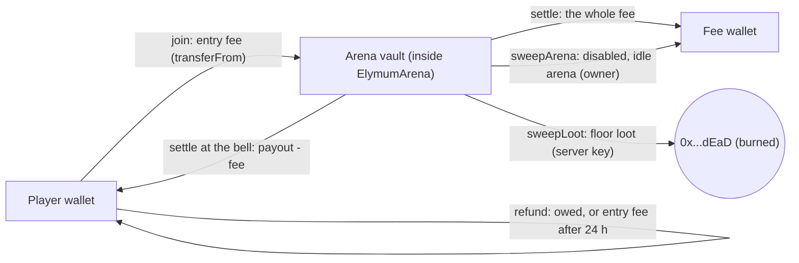

# Elymum architecture

Elymum is a hybrid: an authoritative game server runs the real-time world, and two Solidity contracts on
**Elysium** (Kinetiq's EVM L2, gas token HYPE) hold the money rules. The browser signs its own
transactions (ticket, refund, mint); the server key signs only settlements and loot burns. The spec
behind this page is [`specs/2026-10-29-elymum-on-elysium.md`](specs/2026-10-29-elymum-on-elysium.md).

```
Browser (apps/web) --WebSocket, binary, 30 Hz--> Game server (apps/server) --settle / sweepLoot--> ElymumArena
     |  \__ approve + join / refund (player wallet) ____________________________________________/
     \_____ mintAllowlist / mintPublic (HYPE) ----------------------------------------------------> ElymumNFT
                                     Game server --balanceOf (who may play), setPrice (keeper)--> ElymumNFT
```

## Components

| Component | Where | Role |
|---|---|---|
| `ElymumArena` | `packages/contracts/contracts/ElymumArena.sol` | Arenas, vaults, tickets (sessions), settlements, refunds, loot burns. Ownable2Step, ReentrancyGuard, SafeERC20 |
| `ElymumNFT` | `packages/contracts/contracts/ElymumNFT.sol` | The Elymum NFT: allowlist (Merkle) and public mint at a HYPE price, royalties, metadata. ERC721 + ERC2981 + Ownable2Step |
| `TestToken` | `packages/contracts/contracts/TestToken.sol` | A faucet ERC-20 for localnet and Elysium Testnet only |
| Artifacts | `packages/contracts/src/artifacts.ts` | ABIs (`as const`), creation bytecode, `runtimeCodeHash`; written by `scripts/export-artifacts.mjs`, committed, checked in CI |
| SDK | `packages/sdk` | viem reads, call builders (`ContractCall`), deploy helpers, call previews, Merkle tree, HYPE/USD price, the admin CLI |
| Shared | `packages/shared` | Rules, protocol, the chains table (`chains.ts`), arenas, the SIWE message, the palette |
| Game server | `apps/server` | Rooms, bots, rounds, the off-chain ledger, the journal, the chain gateway (`chain/evm.ts`), the price keeper, site and admin API, integrity |
| Web | `apps/web` | The client and `/admin`; wallets through EIP-6963 (`src/wallet`) and viem |

**No `immutable` variables** in the deployable contracts: the runtime bytecode is the same for every
deployment, so its `keccak256` is pinned in the artifacts and the server refuses to register (or run
against) an address whose code hash differs.

## Chains

| Key | Chain id | RPC | Explorer |
|---|---|---|---|
| `elysium-testnet` | 99801 | `https://testnet-rpc.elysium.kinetiq.xyz` | `https://explorer-elysium-testnet.t.conduit.xyz` |
| `elysium` | read from the RPC | `EVM_RPC_URL` (published by Kinetiq at the Nov 9 launch) | `EXPLORER_URL` |
| `localnet` | 31337 | `http://127.0.0.1:8545` (`hardhat node`) | none |

The native currency is always HYPE (18 decimals). **The server's RPC is the source of truth**: at start the
server reads `eth_chainId` from `EVM_RPC_URL` and publishes `{ chainId, name, rpcUrl, explorerUrl }` in
`/api/config`. The web never assumes a chain id; it asks the wallet to switch to (or add) exactly that
chain. (viem's built-in `elysiumTestnet` export is an unrelated chain and is not used.)

## Money flow



### Ticket lifecycle

1. **Join.** The web checks the allowance and sends `approve` (exact amount) only when it is short, then
   `join(arenaId)`. The contract pulls the entry fee with a balance-delta check (fee-on-transfer tokens are
   refused), opens a session with a global id (starting at 1) and fixes the fee rate (`feeBps`) for it.
   One open session per player per arena.
2. **Play.** The server seats the ticket. Value moves between players off chain (`stake/ledger.ts`).
3. **Settle.** At the bell, or when a player is eaten or the ticket goes stale, the server queues a
   settlement in the journal. Due items of an arena go out as **one `settle(Settlement[])` batch** (chunked
   at 40). Each item is applied or **skipped with an event** (`SettleSkipped`: unknown arena, session
   mismatch, already finalized, vault too small) instead of reverting the batch. The server reads every
   session back afterwards: a skipped or reverted item is retried with backoff; an item whose session id no
   longer matches was settled by someone else.
4. **Two-phase payout.** The fee goes to the fee wallet (a failing fee transfer reverts the batch). The
   player transfer uses `trySafeTransfer`; if it fails the session is **finalized** with `owed`, and the
   player collects it with `refund`.
5. **Refund.** A finalized session: `refund` pays `owed`. An unsettled session older than 24 h: `refund`
   pays `min(entryFee, vault)`.

### Fees (arena v2: fee on entry)

```
fee    = floor(entryFee * feeBps / 10 000)   feeBps fixed at join; 500 (5 %) by default, at most 1 000 (10 %)
value  = entryFee - fee                       what the ticket plays with (the coin's starting value, in the vault)
player = payout                               nothing is deducted at settle; the reserved fee goes to the fee wallet
```

Example: entry 1,000 → fee 50 reserved, the coin starts at 950; it doubles to 1,900 by the bell → the player gets
1,900, the fee wallet 50. A loss or break-even pays the same 50. A ticket that is never played (never seated) is
cancelled by the server (`cancel`) with its full 1,000 back and no fee; the 24 h self-refund also returns the
full entry (the value part capped by the vault).

The legacy v1 arena (still live on the Elysium testnet until it is redeployed, told apart by its code hash)
took `floor(max(0, payout - entryFee) * feeBps / 10 000)` from the payout instead; the server reads the version
and handles both (`ChainStatus.feeModel`).

## Invariants

On chain (`ElymumArena`, custom errors, forge-std unit and fuzz tests):

1. A payout never exceeds the arena's vault (`InsufficientVault`, or `SettleSkipped` reason 4 inside a batch). The
   vault holds the tickets' values; their fees are reserved apart (`Arena.fees`, `arenaFees(id)`) and never spent by
   a settlement or a loot burn. Balance = Σ vault + Σ fees + Σ owed.
2. One open session per player per arena (`SessionExists`).
3. No replayed settlement: the item's `sessionId` must match the open session (`SettleSkipped` reason 2).
4. The fee is a share of the entry fee of every played ticket, at the rate fixed at join, capped at 10 %
   (`InvalidFee`); `cancel` and the 24 h refund return it.
5. The whole fee goes to the fee wallet; a failing fee transfer reverts the batch.
6. Floor loot is only burned: `sweepLoot(arenaId, sweepId, amount)` sends to `0x...dEaD`, needs a strictly
   increasing `sweepId` (`SweepIdNotIncreasing`) and is capped by the vault.
7. The token is set once (`TokenAlreadySet`); arenas and joins need it (`TokenNotSet`). `rescue` can never
   move the game token (`CannotRescueGameToken`).
8. Pause blocks joins only; settlements, refunds and collects keep working.
9. `sweepArena` only for a disabled arena with no open sessions (`ArenaEnabled`, `ArenaHasOpenSessions`);
   the vault goes to the fee wallet.

`ElymumNFT`:

- The allowlist leaf is `keccak256(bytes.concat(keccak256(abi.encode(account))))` with sorted-pair hashing
  (OpenZeppelin `MerkleProof`); per-wallet limits for each phase; `maxSupply` can only go down and never
  below `totalSupply`; payment `>= price * qty` with the excess refunded in the same call; `withdraw` sends
  the whole balance to the treasury; `freezeMetadata` is forever; royalties at most 10 %.
- The price keeper may call `setPrice` only inside `[minPrice, maxPrice]` set by the owner
  (`PriceOutOfBounds`, `NotPriceSetter`).

Off chain (the server, tests in `apps/server/test`):

10. Value conservation per arena: Σ live values + Σ floor loot + Σ bot purses + Σ pending payouts and sweeps
    (+ Σ forfeited) + house reserve = Σ entry fees − Σ paid. The journal (`DATA_DIR/journal.json`) is written with
    write-to-temp + rename. Bot purses count as owed (a person can win them back); the house reserve (the vault
    share of the cut on winnings, purses taken home) is owed to nobody and stays in the vault.
11. Bots never pick up loot. A house bot's purse holds only value taken from stakers it ate.
12. Crash recovery: live tickets found in the journal at start are settled at their last journaled value;
    loot is restored. An arena whose vault does not cover what the journal owes it stays disabled
    (`!!! arena #N KEPT DISABLED`).
13. One arena contract per journal: while the journal owes money on an arena contract, the server refuses
    to switch to another one (`POST /api/admin/contracts` answers 409 `wrong_state`).
14. Stale tickets: a ticket nobody played for `STALE_SESSION_AFTER_S` (15 min) is settled at its entry fee.
    While a quarantined journal (`journal.json.corrupt-*`) exists the stale sweeper stays off.

## Trust model

| Actor | Can | Cannot |
|---|---|---|
| Player | buy tickets, collect `owed`, refund an unsettled ticket after 24 h, mint NFTs, edit the profile | settle a ticket, undo a result, move other players' tokens |
| Server key (`serverAuthority`, optionally the NFT `priceKeeper`) | settle any open session with any payout up to the vault; burn floor loot up to the vault; re-price the NFT inside the owner's bounds | move tokens to a wallet of its choice, touch the fee wallet or the config, open tickets, price the NFT outside the bounds |
| Owner (Ownable2Step) | arena: set the token once, fee (≤ 10 %), fee wallet, server authority, pause, create/update/sweep arenas, rescue non-game tokens; NFT: phase, root, price, bounds, keeper, limits, supply (down only), metadata, royalty, treasury, owner mint, withdraw | change the token once set, change an open ticket's fee, take an arena vault directly |
| Fee wallet | receives the fees and a swept arena's vault | nothing else on chain |
| Server operator | rooms, bots, round length (`ROUND_SECONDS`, `ROUND_JOIN_CLOSE_SECONDS`), who may play (`GAME_ACCESS`) | anything on chain except through the server key |

Consequences, stated plainly in the player guide:

- **The game outcome is trusted.** A buggy or malicious server could split a vault wrongly between that
  arena's players or burn the wrong amount of it (never more than the vault). The owner can replace the
  server key, so trusting the server means trusting the owner. **Protect the server key.**
- **The token is trusted once**: it can never change, so a wrong address means deploying a new arena.
- The contracts are not upgradeable. Ownership moves only in two steps (`transferOwnership`, then
  `acceptOwnership` from the new owner).
- Collusion, multi-accounting and scripted input are detected off chain and shown to the owner
  (OPERATIONS.md, "Integrity"). An optional auto-hold keeps a high-risk payout in the journal until the owner
  releases it or settles it at 0.

## Server internals

- **Config** (`config.ts`): `EVM_RPC_URL`, `PUBLIC_RPC_URL`, `CHAIN_NAME`, `EXPLORER_URL`, `ARENA_ADDRESS`,
  `NFT_ADDRESS`, `SERVER_PRIVATE_KEY` (`auto` | 0x hex | a file path; `auto` keeps the key in
  `DATA_DIR/server-key.json`, mode 0600), `ADMIN_WALLETS` (no default), `GAME_ACCESS`, `MINT_USD_CENTS`,
  `HYPE_PRICE_URL`, `TOKEN_SYMBOL`, `STAKE_ENABLED`, `STAKE_ARENA_IDS`, `STALE_SESSION_AFTER_S`,
  `LOG_CHUNK_BLOCKS`, `DEV_FAKE_CHAIN`, `DEV_FAKE_TOKEN`. See `apps/server/.env.example`.
- **Contracts registry** (`site/contracts.ts`): `DATA_DIR/contracts.json`, written by `POST
  /api/admin/contracts` after a deploy from `/admin`. The server checks the code hash, that the owner is the
  signed-in admin and, for the arena, that the server authority is the server key. `ARENA_ADDRESS` /
  `NFT_ADDRESS` override it. A newly registered arena is picked up without a restart.
- **Chain gateway** (`chain/evm.ts`): reads `config()` every 30 s until the token is set, then pushes `chain` to
  every client (the lobby flips from "Opening soon" to open arenas without a reload); lists arenas; runs the
  settlement worker (batches, read-back reconciliation, backoff), the loot burn with a monotonic `sweepId`
  kept in the journal, and the stale sweeper. Gas is paid by the server key in HYPE; below 0.01 HYPE it logs a
  warning and `/admin` shows it. Journal keys are `<arenaId>:<player lowercase>:<sessionId>`.
- **Price keeper** (`chain/price-keeper.ts`): when the owner has set the server key as the NFT's `priceKeeper`
  and set bounds, every 5 minutes it reads HYPE/USD from Hyperliquid's info API (`allMids`, key `HYPE`) and
  re-prices to `MINT_USD_CENTS` (default 100) when the price is off by more than 2 %, clamped into the bounds. The
  feed is a single source: a move needs two consecutive readings within 3 % of each other, and one update moves the
  on-chain price by at most ±20 %.
- **Sign-in (SIWE, EIP-4361)**: `/api/auth/nonce` issues the message (domain = the `PUBLIC_URL` host, the
  server's chain id, statement "Sign in to Elymum. This is free and sends no transaction."); nonces are single
  use and expire after 10 minutes. Verification uses viem `verifyMessage`, falling back to the public client
  for ERC-1271 / 6492 smart wallets. Addresses are stored checksummed.
- **Who may play** (`gameAccess`: `admins` | `holders` | `public`; `GAME_ACCESS` overrides): holders are
  wallets with `balanceOf > 0` on the NFT (cached 15 s, re-read uncached at every arena seat) plus the admins.
- **Mint API**: `GET /api/site/mint` (contract state, HYPE/USD, price in USD, holders, game access),
  `GET /api/site/mint/proof?wallet=` (`{ eligible, proof, root, onchainRoot }`), `POST|GET
  /api/admin/mint/allowlist` (snapshot of approved WL wallets + submitted collab wallets, EVM only, sorted;
  the diff against current approvals), `GET /api/admin/mint/price`.
- **NFT metadata**: `GET /api/nft/<id>` (JSON, minted ids only), `/api/nft/<id>.svg` (a deterministic emblem),
  `/api/nft/contract` (contractURI).
- **Rooms** (`rooms/manager.ts`): practice instances (Rookie and Pro leagues, 40 humans), arena instances
  `arena-<id>-<n>` of `ARENA_INSTANCE_CAP` (50) humans on the same vault; rounds of 300 s aligned to Unix
  time, joins closed in the final 60 s.
- **Custom rooms** (`rooms/custom.ts`, `site/custom-rooms.ts`, `DATA_DIR/site/custom-rooms*.json`): a
  signed-in wallet pays a native HYPE fee to the treasury (checked on chain by tx hash, each hash used once)
  and gets a room `priv-<CODE>` with its own rules. The capacity is the creator's (2 to the admin's
  `maxPlayers`, at most 100); the fee is `base x (1 + step% x (ceil(capacity / 10) - 1))` (default step 50 %:
  11-20 players x1.5, 21-30 x2, ... 91-100 x5.5), computed by the server whatever the client showed, then
  the holder perk (the free room of the day covers rooms of up to 10 players). `maxSeats` caps the capacity of
  all live custom rooms together. Two kinds:
  - **free**: a `private` room, no stakes, joined with `private:<CODE>` (guests too); it closes at its time.
  - **paid** (a "ticket room"): a private, invite-only **instance of an existing arena** (`mode: 'arena'`,
    `instance: 0`, `stake: { arenaId, buyIn }`). There is no escrow of its own: players buy the normal
    on-chain ticket of that arena (`join`, fee on entry, the arena vault holds the tokens) and join with
    `arena:<id>:<CODE>`; the gateway runs the usual ticket checks (session on chain, not pending, age, holders
    gate, ban, round closed) and seats it there instead of a public instance. Settlement is the normal path:
    the bell settles every ticket in it at value and burns its floor loot (`sweep:priv-<CODE>:<round>`), the
    journal keys are the usual session keys, an unseated ticket is refunded by the stale sweeper, a crash or
    restart recovers it like any other. It is never in the room directory (`list`, `/api/rooms`), never one of
    `arenaInstances` (so quick play, matchmaking and the spectate fallback never pick it), never fields staked
    bots, and the idle cleanup never closes it. A live ticket comes back to wherever its coin is
    (`findArenaStake` covers paid rooms), so a resume or reconnect works either way. `private:<CODE>` on a
    paid room answers `paid_room`. **Timing**: a paid room follows the arena's round clock: it ends on the
    first bell at or after its duration (15/30/60 min are whole rounds), and when its time is up or it is
    closed early (creator, admin) it takes no new seat and closes only once nothing of value is left in it
    (no ticket, no loot, no player: `Room.closeSettled`, also in a room worker), i.e. right after its bell. A
    ticket is never evicted. Holders-only arenas are offered to emblem holders only (and the contract refuses
    other buyers anyway). The admin card turns paid rooms on or off.
- **Other REST**: `/api/health`, `/api/rooms`, `/api/leaderboard`, `/api/config`, `/api/pending?wallet=`,
  `/api/profile` (names and skins live on the server), the site API `/api/site/*` and the admin API
  `/api/admin/*`. With `WEB_DIST` the server also serves the web build.
- **Dev fake chain** (`chain/dev-fake.ts`, `DEV_FAKE_CHAIN=1` with `NODE_ENV=development` only): an in-memory
  chain with free tickets and simulated settlements, for `pnpm demo` and the screenshot tours. It refuses to
  start next to `EVM_RPC_URL` or `SERVER_PRIVATE_KEY`.

## Threads (`GAME_WORKERS`)

The game server is one process. With `GAME_WORKERS` = N > 0 (default in production:
`availableParallelism() - 1`, at least 1; default elsewhere: 0) the rooms run in N `worker_threads`;
with 0 everything runs on the main thread exactly as before (tests, `pnpm dev`).

```
              main thread                                         room worker k (one per core but one)
 ws accept, HTTP, site/admin API, auth             cmds ──►       Room × n: World tick, BotManager,
 chain (evm.ts) + journal (ONE writer)        (batched, FIFO)     ViewState snapshots, integrity monitor
 profiles, leaderboards, shop, custom rooms     ◄── ctl + frames   (WorkerConn: frames into one buffer
 room directory + placement (RoomManager)      (one transferred    per batch, tagged with conn + room)
 sockets: ws.send of the workers' frames        ArrayBuffer/tick)
```

- **What runs where.** A worker (`rooms/remote/host.ts`) runs whole rooms with the unchanged `Room` class:
  simulation, bots, snapshot building and encoding. The main thread keeps every socket, the HTTP/site API,
  auth, the chain gateway, the journal, the stores (profiles, leaderboards, shop charges, custom-room
  records, integrity flags) and the room directory (`RoomManager` with `RemoteRoom` proxies,
  `rooms/remote/pool.ts`). A new room instance goes to the least-loaded worker (measured tick time, plus the
  rooms placed since its last report).
- **Sockets.** Terminating ws in a worker is not possible (a `net.Socket` cannot move between threads), so
  the main thread keeps them; it forwards inputs (batched per event-loop turn) and writes the frames a
  worker produced. A worker writes every frame of a tick (snapshots straight from the room's writer, JSON
  messages UTF-8 encoded) into one buffer that is transferred, not copied, to the main thread; the main
  thread sends `subarray` views of it. Each frame names its room: frames of a room the connection has left
  are dropped (its next room starts the client afresh with `joined` / `spectating`), and while a reattach is
  being answered the frames of both rooms wait, so the client never sees a frame of the wrong room. A socket
  backed up past 768 KB makes the worker skip its snapshots, as on one thread.
- **Money paths are main-thread only and keep their order.** A room's journal writes (`commit`: settlements,
  live stakes, floor loot, in one atomic write) reach the main thread as `commit` entries in the order the
  room made them, together with the frames and events around them (one FIFO port per worker), and are
  applied there with `Journal.commit`; the main thread kicks the chain worker after each one that queues an
  item. The directory's view of seated tickets comes from those writes plus the stake joins it has sent and
  not yet seen answered, so `liveSessions` (the stale sweeper, double-seat checks) never misses a ticket.
  The integrity auto-hold is decided on the main thread before the settlement is written (the worker only
  runs the telemetry); power-up charges are taken on the main thread and given back when the worker could
  not apply the effect (the player died meanwhile); staked-bot tickets are bought on the main thread and
  handed to the worker; a loot-sweep key that is already pending is renamed there, as a room on one thread
  does.
- **A worker that dies or hangs** (no message for `GAME_WORKER_HANG_S`, default 10 s; the main thread's own
  stalls are not counted) is terminated and nothing it sends afterwards is applied. Its rooms are recovered
  from the journal like a process restart (`Journal.recoverRooms`, one atomic write): every ticket journaled
  live in them is settled at its last journaled value (reason `crash`; a ticket already pending is never
  queued twice), and their floor loot is queued to burn (a `sweep` item per room, since those rooms are
  gone; a restart would put it back on the first instance's floor). What the room did after its last journal
  write is lost, exactly as with a crash of the whole process. The sockets of those rooms are closed (1012),
  the clients reconnect; the worker is started again (backing off if it keeps dying) and the directory
  reopens the standing rooms (first ponds, every arena's first instance, custom rooms with time left).
- **Shutdown.** `SIGTERM` asks every worker to settle its stakers (`Room.shutdown`, an operator exit) and
  waits for their last journal writes (5 s each; a worker that does not answer is recovered as above).
- **Load.** Each thread reports its tick (mean / p95 / max), event-loop utilisation and lag, rooms and
  players every second: `GET /api/admin/load`, the Network tab ("Game server load") and `game` in
  `/api/health`.
- **Tests.** The usual suite runs with 0 workers; `pnpm -F @elymum/server test:workers` runs the WebSocket
  integration suite with two workers (`TEST_GAME_WORKERS=2`) plus `test/workers.test.ts` (bell settlement,
  reattach, crash and hang recovery, custom-room close, shutdown).

### Capacity (measured)

`pnpm -F @elymum/server load` (`scripts/bench/load.ts`) runs the real app with N WebSocket clients in child
processes (35 % arena players with tickets on the dev fake chain, 45 % practice, 10 % private, 10 % custom
rooms; aim updates at 30 Hz, rejoin after a death), default bots in every room. Measured on a 4-core
sandbox with the clients on the same machine (about 0.45 cores for 500 clients):

| Clients | Threads | Worst thread tick p95 | Main event-loop lag p99 | Server CPU | RSS | Out |
|---|---|---|---|---|---|---|
| 100 | 1 (`GAME_WORKERS=0`) | 16 ms | 18 ms | 0.43 cores | 0.2 GB | 0.55 MB/s |
| 150 | 1 | 25 ms | 28 ms | 0.58 cores | 0.2 GB | 1.2 MB/s |
| 250 | 1 | 36 ms | 58 ms | 0.95 cores | 0.3 GB | 1.6 MB/s |
| 500 | 1 | 64 ms (busy 100 %, snapshots every 50 ms) | 233 ms | 1.09 cores | 0.3 GB | 2.3 MB/s |
| 250 | main + 3 workers | 7.4 ms | 3.6 ms | 0.93 cores | 0.5 GB | 1.5 MB/s |
| 500 | main + 3 workers | 19 ms | 7.6 ms | 1.67 cores | 0.6 GB | 3.4 MB/s |
| 600 | main + 3 workers | 24 ms | 12 ms | 1.99 cores | 0.7 GB | 4.2 MB/s |

One thread tops out near 150 clients. The cost is mostly per connection (building and sending each
client's snapshot 30 times a second), then bots, then the simulation. With workers the main thread costs
about 0.09 % of a core per client (sockets, inputs, frame delivery: 0.42 at 500) and each worker about
0.065 ms of tick per player. On a 6-vCore VPS (main + 5 workers), 500 players are about 95 per worker:
a tick of ~6 ms mean (of 33 ms), the main thread under half busy, about 1.7 cores used in all. Each client
receives about 6.8 KB/s (500 clients: 27 Mbit/s of the 2 Gbit/s link).
