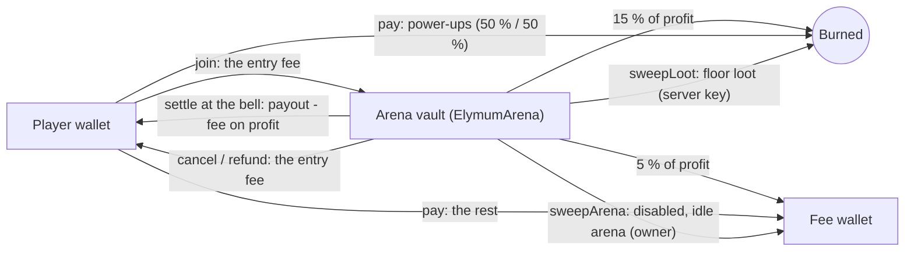

# Elymum: the whole project on one page

Elymum is a cute coin-eats-coin arena game on **Robinhood Chain** (an Arbitrum Orbit L2, gas token **ETH**). The
money rules live in Solidity contracts, the game runs on an authoritative server, and an **Elymum NFT** minted for
**$1 in ETH** opens the game. This page explains how the game plays, how money moves, how the code is laid out and
how it is run. Details: [ARCHITECTURE.md](ARCHITECTURE.md), [ECONOMY.md](ECONOMY.md), [RESEARCH.md](RESEARCH.md)
(the specs under `docs/specs/` are historical: they describe the earlier Elysium build).

> **Status (2026-11-05).** Elymum runs on **Robinhood Chain only**: Robinhood Chain Testnet (46630) now, Robinhood
> Chain (4663) later, switched with `CHAIN_ID`. The arena contract is v3 (no entry fee; 20 % of a ticket's profit:
> 15 % burned, 5 % to the fee wallet). Arenas and practice ponds are played by people only; fair practice bots exist
> only in free custom rooms. The flow is **WL → Mint → Play**; the owner deploys every contract from their own wallet
> in `/admin`. The contracts have **not been audited**, and a game played with a token of real value may need a
> licence where you operate.

---

## 1. The game in 30 seconds

- You are a coin. Eat food and smaller coins to grow, and run from bigger ones.
- Practice rooms are free, two leagues (Rookie and Pro), people only, and touch nothing on chain.
- Arenas are paid rooms with a fixed entry fee in `$ELYMUM` (the game token the owner sets after deploy).
  - Your value starts at the whole entry fee; eat a player and their value moves to you.
- Rounds: 5 minutes on the wall clock, the same for every arena. No cash-out: at the bell everyone still alive is
  paid their value on chain, less 20 % of their profit (15 % burned, 5 % to the fee wallet); a loss pays no fee.
- Re-entry: eaten? Buy back in at the same fee while joins are open (they close in the final minute).
- The NFT: the Elymum NFT (an emblem) mints for $1 in ETH, allowlist first, then public. The owner decides who
  may play: admins only, NFT holders, or everyone.
- The token is set after deploy: until the owner sets it on the arena (once), the arenas read "Opening soon".

## 2. Game mechanics

### 2.1 Movement and eating

| Rule | Value (source: `packages/shared/src/constants.ts`, `RULES`) |
|---|---|
| Simulation and snapshot rate | 30 ticks per second, authoritative server |
| Start mass | 20 |
| Eating | needs at least 1.25 × the victim's mass and enough overlap (the victim must be mostly covered) |
| Speed | `2185 · r^-0.44` up to radius 100 (mass 100), then a gentler `r^-0.3` falloff, so bigger coins are slower (about 410 u/s at start size) |
| Split (`Space`) | needs at least 35 mass; up to 16 cells; launch speed 1440 (about 450 units of flight); halves merge back after 12 s + 15 ms per unit of mass |
| Eject mass (`W`) | needs at least 35 mass; costs 18 and throws a 14-mass blob at 1150 u/s |
| Viruses (spiky cacti) | mass 100. A coin at least 1.33 × that size pops into as many as 15 pieces. Feeding a virus 198 mass makes it shoot a new one. |
| Decay | above 150 mass you lose 0.15 %/s, plus an extra term that grows with total mass, so giants melt faster |
| Maximum cell mass | 12,000 |
| Food | pastel coins (1 mass), gems (2), golden coins (8); refills at 60 per second |
| Power-ups | Magnet (10 s), Pump (6 s, × 1.4 speed), Shield (8 s), Bag (+15 % mass, at least 40) |
| Bought power-ups (lobby shop, `packages/shared/src/boosts.ts`) | Magnet `R` (8 s), Leap `F` (instant hop toward the aim, 420 + 0.9·r units, at most 900, never through the wall), Speed `G` (3 s), Invisibility `V` (10 s: the server sends the coins to nobody else, practice bots and minimap leader dots skip them; eating works as usual). The Shockwave was retired in 2026-11: saved charges, prices and switches load as Leap 1:1 |
| Spawn shield | 3 s |
| Room sizes | Adaptive (default): side = 800 · √(expected players), 9,000..12,000 (up to 126 players 9,000, 144 players 9,600, 200 players 11,400, 225+ 12,000); auto off: Practice 6800², Private 4600², Arena 7800². Humans per instance: Practice 40, Arena 50 |

### 2.2 Controls

| Action | Desktop | Phone |
|---|---|---|
| Move | mouse | joystick |
| Split | `Space` or left click | split button |
| Drop mass | `W` (can be held) | tip button |
| Chat / sticker | `Enter` / `1`–`8` (`9` flips the sticker page: Hype or Trash talk) | chat / sticker buttons (with a page switch) |
| Next player while spectating | `Q` | |

### 2.2.1 Practice bots (free custom rooms only)

- **No bots in arenas or practice ponds.** The house squad, staked testnet bots, bot purses, team reserve, traps and
  the final-minute push were removed in 2026-11 (with their settings, files and admin switches; saved settings load
  with the retired keys ignored).
- A **free** custom room may field practice bots: its creator turns them on and picks the count (1 to 12) and the
  difficulty (easy, mixed, hard). Ticket rooms and every other room refuse them (`Room` throws).
- Fair by construction (`apps/server/src/bots/brain.ts`): a bot sees only what the server would show a player of its
  size (its view rectangle; invisible players excluded), re-thinks every ~420 / 260 / 160 ms (easy / normal /
  hard; "mixed" rolls a third of each), aims with an error, flees bigger coins, hunts smaller ones (not on easy),
  splits for a kill only on hard, eats food, keeps off walls and cacti. No map-wide knowledge, no teamwork.
- Bots carry no value, never pick up loot, never use power-ups, are named "Bot N" and always wear a BOT tag. An eaten
  bot comes back 3 to 7 s later.

### 2.2.2 Dynamic map size

- Every room's square map grows a little with every person who joins (plus a free custom room's practice bots) and
  shrinks back as they leave, only when that is safe (`packages/shared/src/map-scale.ts`, one model):
  `side = min(max, base + perPlayer × people)`, rounded up to 10, never below `base`. Food, cacti and power-ups
  follow the area at a practice pond's density (capped at 4,000 food and 40 cacti): a 10,000 room has about 3,500
  coins, 30 cacti and 6 power-up slots.
- Defaults (every room kind): base 8,000, 40 per person, max 12,000. 1 person 8,040, 25 people 9,000, a full pond
  (40) 9,600, a full arena instance (50) 10,000, 100 and more 12,000.
- Admin (`/admin` → Game → Maps, `/api/admin/maps`, stored in `DATA_DIR/site/maps.json`; the maps of an older
  `site/bots.json` are taken over once): per room kind (practice rookie / pro, arenas, private rooms), `auto`
  on/off, `base` and `max` side (2,000..12,000) and `perPlayer` (0..300 per person). A kind saved in the former
  square-root model (`min`, no `base`) keeps its `auto` and takes the defaults on load. Auto off keeps the mode's
  fixed preset.
- When: during play the map only grows, by at most 600 units every 4 s (a burst of joins opens the floor in a few
  gentle steps). **An arena (public instance or ticket room) never shrinks during a round**, whatever it reached:
  it takes its new size at the round start, right after the bell settled every coin, sized for the people at the
  bell. Rooms without rounds (ponds, free custom rooms) shrink step by step, at most 600 every 4 s, only once the
  target is 200 or more below the current side (a person or two coming and going does not move the wall) and only
  over empty floor (no person's coin within 300 of the band that goes): nobody is trapped. The playable square sits
  centred in a fixed 12,000 space, so it opens on every side and the server's spatial grids never need rebuilding.
  Clients get the bounds in the snapshot and ease the border, minimap and camera over 1.5 s.
- Cost: a room checks its size once a second and resizes at most every 4 s; a resize is one pass over the entities
  (growing is next to free), so 500 people cost nothing measurable (`test/map-bench.test.ts`).
- Custom rooms: "Auto" (the default) follows the private rooms' settings for its people plus its practice bots; a
  chosen size (XS 3,000 .. XL 9,000) never changes.
- `pnpm -F @elymum/server exec tsx scripts/bench/map-bench.ts [players] [people] [seconds]` times a full room on
  the dynamic map against the fixed arena preset, and the resizes themselves; `map-bench.ts rooms [rooms]
  [players] [people] [seconds]` times several quiet rooms in one process on the default and a small model.

### 2.3 Value inside an arena (off-chain ledger)

- A ticket's value starts at its entry fee.
- Eating a cell moves `floor(V · m / M)` of the victim's value to the eater: `V` is the victim's value, `m` the
  mass of the eaten cell and `M` the victim's total mass. The last cell moves whatever is left.
- Only tickets hold value. Should anything without a ticket ever eat a staker (nothing does in a room of people
  only; the rule stays for safety), the share spills across the map as loot in
  `clamp(ceil(V / (fee × 0.25)), 3, 24)` pieces that only stakers pick up; it stays until the round ends and is
  burned.

### 2.4 Rounds (paid arenas only)

| Rule | Value |
|---|---|
| Round length | 5 minutes, aligned to Unix time: round *n* runs `[n·300 s, (n+1)·300 s)` for every arena and instance |
| Joins | open in the first 4 minutes, closed in the final 60 s |
| A ticket bought while joins are closed | held; the client joins it automatically when the next round opens (0–1.5 s jitter, up to 5 attempts) |
| Eaten | you get 0 for that ticket; buy back in at the same fee while joins are open |
| Disconnect (AFK) | your cells stay in the arena until they are eaten or the bell rings, so leaving is not an early exit |
| The bell | every live ticket, connected or AFK, is settled at its current value; the world resets and a new round starts at once |
| Floor loot at the bell | collected and **burned** with `sweepLoot` |
| Exits that still settle at the current value | admin kick and server shutdown (operator actions, not player choices) |

On screen:

- Round chip: shows `m:ss`, switches to "Final minute" for the last 60 s and shows a large countdown in the last 10 s.
- Bell: the world freezes and the Round over receipt appears, with your till, the fee on your profit, the amount paid, your
  place, the top 5 (value at the bell, mass and kills; your own row when you are below them) and a PAID stamp. It is the
  same final board a custom room shows at its end (`FinalBoard`, `RoundStanding` rows).
- Lobby rows: each arena shows either "Round ends in 3:12" or "Joins closed · next round in 0:42".
- Death sheet: offers "Buy back in", or "Next round in" while joins are closed.
- Sound: a soft tick each second in the last 10 s and a bell at the end.
- Announcer: "One minute left.", "Ten seconds.", "Round over.".

### 2.5 Arenas

| Arena | Entry fee |
|---|---|
| Asphodel Meadow | 1,000 `$ELYMUM` |
| Lethe Shore | 10,000 `$ELYMUM` |
| Golden Bough | 50,000 `$ELYMUM` |
| Isles of the Blessed | 250,000 `$ELYMUM` |

Ids 1 to 4, created from `/admin` → Setup → Finish setup (or `pnpm admin create-arena --defaults`) once the token is
set, 300 open tickets each; the Isles are for emblem holders. Each arena runs as 50-player instances on the same vault:
another opens when they keep filling up, a quiet one drains (no new seats) and closes after its bell, nobody evicted
(OPERATIONS.md, "Arena instances").

Custom rooms: a player pays a small ETH fee (default 0.0005 ETH, ECONOMY.md) for a room with their own rules and capacity (2 to 100; the fee
grows 50 % of the base for every started 10 players above 10). A **free** room has no stakes and may add practice bots. A **ticket
room** is an invite-only instance of one of the arenas above: its players buy that arena's normal ticket and
are seated there by the invite code; it plays on the arena's round clock (it ends on a bell) and is settled at
the bell like any arena. Quick play never lands in one. Details: [ARCHITECTURE.md](ARCHITECTURE.md), "Custom rooms".

A custom room never closes abruptly. Ten seconds before its end (time up, or closed early by its creator or an admin)
everyone in it, players and spectators, sees a countdown with the reason; then a free room shows its **final standings**
(everyone by mass, practice bots included, with kills; your own row) and goes back to the lobby on "Lobby" or after
30 s. A ticket room ends on its bell: the countdown runs into the bell, whose receipt carries the same board with the
values. A free room closed early ends 10 s later; a ticket room closed early ends at the round's bell.

**Share on X.** A bell's receipt and a custom room's final board carry "Share on X"; eating a person whose coin reached
1,000 mass shows "You ate …!" with the same button for a few seconds. It opens X's composer with a localized line ("I
just ate Nakamoto on Elymum!") and a link to `/share/<id>`, whose card image (the coin, the place or the kill, mass,
kills, what was paid, the flag code and emblem badge, the wallet's short form) the server draws from its own records.

**Practice with bots.** The ponds are people only, so at quiet hours they say so honestly: with fewer than two
people in the ponds the lobby shows "Quiet right now" (invite friends, or practice with bots), and a player alone in
a pond sees the same as a small sticker. "Practice with bots" opens, in one click and free (guests too), a short-lived
free custom room of their own (`PRACTICE_ROOM`: 8 practice bots of mixed difficulty, auto map, 15 minutes, room for
3 friends with its code). Abuse limits instead of the creation fee: one live practice room per player (asking again
returns it), 4 creations per IP per 30 minutes, at most `practiceMaxLive` (12) at once outside the paid rooms' slots
and seats, and it closes as soon as it has stood empty for 2 minutes. `POST /api/rooms/custom/practice`.

## 3. Money

### 3.1 The fee on profit (ElymumArena v3)

There is no entry fee: the whole ticket price goes into the arena vault and the coin starts at it. When a ticket is
settled for more than its entry fee, the arena contract takes a fee from the **profit**: 15 % is burned (the token's
`burn()` in burn mode 1, else `0x…dEaD`) and 5 % goes to the fee wallet. A loss or a break-even pays nothing. The rates
are fixed into the ticket at join, owner-settable for new tickets, together at most 25 %; emblem holders may get a
lower pair. The numbers live in one module, `packages/shared/src/fees.ts` (the contract's `computeFees`).

```
profit  = max(0, payout - entryFee)
burned  = floor(profit x 15 %),  toVault = floor(profit x 5 %)
player  = payout - burned - toVault
```

Example: entry 1,000, payout 2,000 → 150 burned, 50 to the fee wallet, 1,800 to the player. Power-up packs are paid
to the same contract (`pay`): 50 % burned, 50 % to the fee wallet. Every flow: [ECONOMY.md](ECONOMY.md).

### 3.2 Where tokens live



- Two-phase settle: if the payout transfer to a player fails, the session is finalized with what is `owed`, and the
  player collects it with `refund` at any time.
- Unplayed tickets: the server cancels them (`cancel`): the full entry fee back, no fee.
- Refund: a ticket the server never settled can be refunded by its player after 24 h (`min(entryFee, vault)`).
- Off-chain conservation: per arena, live values + floor loot + pending payouts (+ forfeits) = entry fees − payouts,
  kept in a crash-safe journal.

### 3.3 The token and the mint

- The arena is deployed without a token; the owner sets `$ELYMUM` once (`setToken`, typed twice in `/admin`). It can
  never change. Until then the server plays practice only and the arenas show "Opening soon"; when it is set the lobby
  opens the arenas without a reload.
- The NFT price is held in wei and kept at `MINT_USD_CENTS` (default $1) of ETH: by the owner's Sync button, or by
  the server as price keeper inside the owner's bounds (every 5 minutes, only when off by more than 2 %).
- The allowlist is every approved WL wallet plus every wallet of a submitted collab list; the owner publishes its
  Merkle root.

## 4. Architecture

**Hybrid model.** The server runs the physics; the contracts enforce the money rules; the browser signs its own
transactions (approve, join, refund, pay, mint); the server key signs only `settle`, `cancel`, `sweepLoot` and (as
keeper) `setPrice`. A ticket approves the game token once for every later ticket by default (the largest allowance), so
later tickets are a single `join` prompt; "Approve only this ticket" in the confirm sheet (remembered per browser)
approves exactly each entry fee instead. Shop packs are paid with the arena's `pay` (covered by that approval, or an
exact one); custom rooms with a plain ETH transfer. Details: [ARCHITECTURE.md](ARCHITECTURE.md).

| Path | What it is |
|---|---|
| `packages/contracts` | `ElymumArena` v3, `ElymumNFT`, `TestToken` (Hardhat 3, Solidity 0.8.28, OpenZeppelin 5.6.1, forge-std unit, fuzz and invariant tests); `src/artifacts.ts` is committed and pins the runtime code hashes |
| `packages/sdk` | viem reads, call builders, deploy helpers, call previews, Merkle tree, ETH/USD price, the admin CLI (`pnpm admin`) |
| `packages/shared` | Rules (`RULES`), the binary protocol, the fee module (`fees.ts`), the Robinhood Chain networks (`chains.ts`), arenas, the SIWE message, the palette |
| `packages/art` | The coin drawing used by the web renderer and the films |
| `apps/server` | The game server: rooms, rounds, practice bots (free custom rooms), ledger, journal, `chain/evm.ts`, the price keeper, the site, mint, NFT metadata and admin API, integrity |
| `apps/web` | The client: landing, `/wl`, `/collab`, `/mint`, `/play`, `/docs`, `/admin`; wallets via EIP-6963 + viem (`src/wallet`) |
| `scripts/` | `demo.mjs`, `localnet.mjs`, `localnet-fund.mjs`, `dev-browser.mjs`, `record-walkthrough.mjs`, the Dev Wallet (`lib/dev-wallet.mjs`) |
| `brand/` | The brand kit generator and its PNGs (section 9) |
| `media/` | Film pipelines (section 10) |
| `docs/` | This page, ARCHITECTURE, ECONOMY, RESEARCH, DEPLOY, OPERATIONS, the historical specs and the design reference |

**Contract guarantees, in short:** a payout never exceeds the vault; one open ticket per player per arena; a
settlement cannot replay (the session id must match); the fee is on profit only, at rates fixed at join, capped at
25 %; balance = vaults + owed; the token is set once; floor loot is only burned; pause blocks joins only. On the NFT: allowlist proofs (Merkle), per-wallet limits,
excess payment refunded, the keeper prices only inside the owner's bounds, supply only goes down, metadata can be
frozen forever.

**Sign-in** is SIWE (EIP-4361): the statement is "Sign in to Elymum. This is free and sends no transaction."; smart
wallets are verified with ERC-1271 / 6492.

## 5. Run, test, deploy, operate

```bash
corepack enable && pnpm install
pnpm demo                        # full stack on a fake chain (token set)
DEV_FAKE_TOKEN=0 pnpm demo       # token unset: "Opening soon" until POST /api/dev/token
ROUND_SECONDS=90 pnpm demo       # short rounds
pnpm demo:localnet               # hardhat node + contracts deployed with the SDK + the production server
pnpm demo:record                 # the walkthrough video (fake chain)
pnpm check                       # everything CI runs, one suite at a time
pnpm typecheck && pnpm test      # every package
pnpm contracts:build && pnpm contracts:test
pnpm -F @elymum/server e2e       # real hardhat node + real server, the deploy order end to end
```

| Topic | Where |
|---|---|
| Robinhood Chain, Render, env vars, the domain, the `/admin` deploy flow, mainnet | [DEPLOY.md](DEPLOY.md) |
| Robinhood Chain and Pons facts with sources | [RESEARCH.md](RESEARCH.md) |
| Sinks, fees, prices, the NFT's utility | [ECONOMY.md](ECONOMY.md) |
| Testnet deploy step by step, fees and burn mode, server key gas, allowlist, $1 price, pausing, mainnet, ownership, key rotation, backups, integrity | [OPERATIONS.md](OPERATIONS.md) |
| Money flow, invariants, trust model, server internals | [ARCHITECTURE.md](ARCHITECTURE.md) |

## 6. Trust model in one table

| Actor | Can | Cannot |
|---|---|---|
| Player | buy tickets, collect what is owed, refund an unsettled ticket after 24 h, pay for power-ups, mint | settle a ticket, undo a result |
| Server key | settle tickets with any payout up to the vault; cancel unplayed tickets; burn floor loot up to the vault; re-price the NFT inside the bounds (if keeper) | move tokens to a wallet of its choice, touch the fee wallet or the config, mint |
| Owner (Ownable2Step) | token once, the fee pair on profit (≤ 25 %), holder pair, burn mode, payment burn share, fee wallet, server authority, arenas, pause, sweeps; NFT phase, root, price, bounds, keeper, limits, metadata, royalty, withdraw | change the token once set, change an open ticket's rates, take a vault directly |

The game outcome trusts the server, and the owner can replace the server key, so trusting the server means trusting
the owner. Protect the server key.

## 7. Deployment

| Item | Value |
|---|---|
| Chain | **Robinhood Chain Testnet** (`CHAIN_ID=46630`, RPC `https://rpc.testnet.chain.robinhood.com`, explorer `https://explorer.testnet.chain.robinhood.com`), later **Robinhood Chain** (`CHAIN_ID=4663`, a provider RPC) |
| Contracts | deployed by the owner from `/admin` → Setup and registered with the server (`DATA_DIR/chains/<id>/contracts.json`) |
| Server key | `SERVER_PRIVATE_KEY=auto`, on the persistent disk; pays gas in ETH |
| Admins | `ADMIN_WALLETS` = the owner's 0x address (no default) |
| Hosting | one Docker container (game server + web) on Render with a persistent disk at `/data` |
| Domain | the site is served at `PUBLIC_URL` (your current domain); elymum.io can be set later by changing `PUBLIC_URL` / `VITE_PUBLIC_URL` and the DNS |

## 8. Website, allowlist, collabs and the admin panel

| Route | Who | What |
|---|---|---|
| `/` | everyone | The landing in the Ring Storybook style: the ring at dawn, the coins, how a round works, the NFT plate, the arenas, FAQ, X @elymumio. CTAs: Join the WL, Collab |
| `/wl` | everyone | "Three small chores": the admin-defined steps (follow @elymumio, repost the pinned post, connect an EVM wallet with a free SIWE signature), one entry per wallet and per X handle, a shareable boarding pass |
| `/collab` | communities | Apply → in review → approved with spots and a deadline → raffle on X → paste the winners' EVM wallets → submit (locks) |
| `/mint` | everyone | The mint after dark: phase, eligibility and proof, quantity, price in ETH with its USD value; minted emblems and a Play button when the game is open to holders |
| `/play` | per `gameAccess` | The game: admins only, holders, or everyone |
| `/admin` | `ADMIN_WALLETS` | Launch, Setup, Mint, Game, Network, Play, WL, Tasks, Collabs, Integrity, Settings (OPERATIONS.md) |
| `/docs` | everyone | The player guide |

**Admin panel safety:** the wallet must be on the server's chain and be the contract owner; every transaction is
previewed (function, arguments, value, network, signer) before the wallet prompt; the token address is typed twice;
double clicks cannot send twice; mainnet shows a red MAINNET banner.

**Integrity:** cheat and collusion flags from arena play (repeated value between wallets, feeding, shared IP or
browser, bot-like input, round-bell patterns), bans from paid arenas and an optional auto-hold of high-risk payouts.
Details: [OPERATIONS.md](OPERATIONS.md#integrity-cheat-and-collusion-detection).

## 9. Brand

- Look: "Ring Storybook" (spec section 6; reference `docs/design/storybook-reference.html`): a picture book of the
  ring habitat, ink outlines `#04181C`, flat cel colour with one shade, hard offset shadows, cream die-cut stickers,
  coins with faces; day = the plain at dawn, night = in orbit.
- Palette (`packages/shared/src/palette.ts`): teal `#2D7388`, cyan `#34B7DD`, sun `#F2C14E`, up `#3C9A87`, cream
  `#F6EEDA`, plain `#F8F7F4`, trench `#0F2A30`, and the rest of the spec's table.
- Type: Fraunces (display, SOFT 100), DM Sans (reading), Geist Mono (numbers and kickers).
- Kit: `node brand/generate.mjs` renders the X avatar and banner, the OG card (also `apps/web/public/og-elymum.png`),
  the favicons, posts (WL open, $1 mint, game live), stickers and arena posters into `brand/out/`
  ([brand/README.md](../brand/README.md)).

## 10. Media

Film sources in `media/`, renders in `out/videos/` (gitignored): the promo, gameplay, how-to-play, the mint film and
Roadmap Chomp. Their text, voice lines, handles and colours are rebranded; they **must be re-rendered after the new UI
lands** ([media/README.md](../media/README.md)).

## 11. Launch checklist

| Step | Who |
|---|---|
| Server on Render with a persistent disk, `ADMIN_WALLETS`, `SERVER_PRIVATE_KEY=auto`, testnet RPC | owner |
| Fund the server key with ETH | owner |
| `/admin` → Setup: TestToken, Arena, NFT, Finish setup (testnet first; OPERATIONS.md) | owner |
| WL open; review WL and collabs | owner |
| Publish the allowlist root; Sync to $1; open the mint (Allowlist) with "activate the game for holders" | owner |
| `$ELYMUM` exists → Set token (once) → create the four arenas | owner |
| Public mint; optional price keeper with bounds | owner |
| Mainnet: launch the token on Pons, `CHAIN_ID=4663` and a provider RPC, redeploy the contracts on mainnet | owner |
| Re-render the films, regenerate the screenshots, upload the X art | owner |
| Security audit; legal review for a real-money game | recommended before opening |

## 12. Decision log

| Date | Decision |
|---|---|
| 2026-10-14 | Token arenas, the coin characters, English-only project |
| 2026-10-15 | Paid arenas play 5-minute rounds: no cash-out, late join and buy-back, paid at the bell |
| 2026-10-16 | One simple model: flat 5 % fee on profit to the fee wallet; floor loot burned; the token set after deploy |
| 2026-10-17 | Browser-wallet admin panel; the site becomes a landing page with WL and collab applications |
| 2026-10-29 | The project becomes **Elymum on Elysium**: two Solidity contracts, EIP-6963 + viem wallets, SIWE, the Elymum NFT at $1 in HYPE, WL → Mint → Play, everything deployed from `/admin`, the Ring Storybook design |
| 2026-11-03 | Playtest fixes: bots fair to people (one or two chasers per person, short chases, rare split attacks, reaction delay and aim error, admin `strength`), rooms of ~12 players at 10,000 (map default 1,000 / 10,000 / 12,000), one token approval for every ticket by default |
| 2026-11-05 | Rebuild: **Robinhood Chain only** (testnet now, mainnet later; the Elysium build retired). **ElymumArena v3**: no entry fee, 20 % of a ticket's profit (15 % burned, 5 % to the fee wallet, owner-settable, at most 25 %), burn mode (token `burn()` or `0x…dEaD`), power-ups paid with `pay` (50 % burned). **People only** in arenas and practice: the house squad, staked bots, purses and reserve removed; fair practice bots only in free custom rooms. One fee module (`shared/fees.ts`); `pnpm check` |
| 2026-11-02 | (superseded by v3) The fee moves from profit to the entry: every played ticket pays 5 % of its entry fee (holders 3 %), win or lose; unplayed tickets are refunded in full. ElymumArena v2 (`version()` 2); the server handles the legacy v1 testnet arena until it is redeployed. The leaderboards are reset once (epoch 2) |
